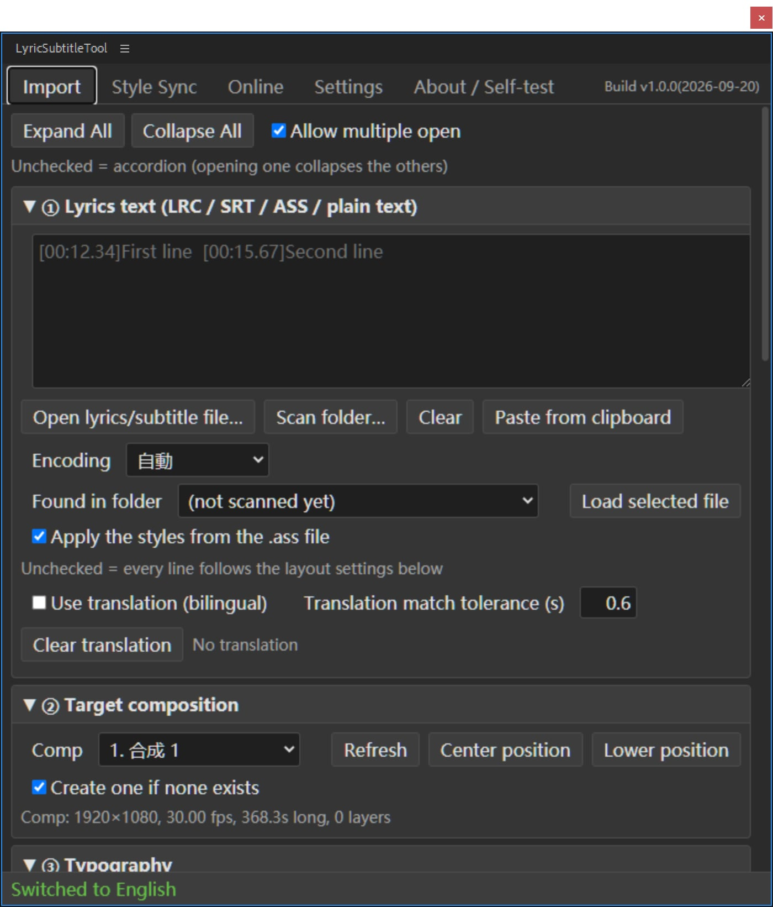

# LyricSubtitleTool · 歌词字幕排版工具

[English](README.md) ｜ [简体中文](README_SC.md) ｜ [繁體中文](README_TC.md) ｜ [日本語](README_JP.md)

Turn LRC / SRT / ASS / VTT / plain-text lyrics into **batched After Effects text layers**,
or a **Premiere Pro caption track**, in one pass.

<p align="center">
    <a href="LICENSE"></a>
    <a href=""></a>
    <a href=""></a>
    <a href=""></a>
</p>


---

## What it does

**After Effects**

| Feature | Details |
| --- | --- |
| Batch subtitles | Point it at a `.lrc` / `.srt` / `.ass` / `.vtt` and it creates one subtitle layer per line inside the comp, with in/out points already lined up |
| Bilingual subtitles | Original and translation can share one layer (two lines) or each take their own layer (line spacing is computed for you, the whole group stays centered) |
| Batch style sync | Hand-build one subtitle layer, then push its font / stroke / position / animation / keyframes / expressions / effects / masks onto dozens or hundreds of layers. Accepts layer-number ranges like `1-10` or `1,5,10` |
| Rebuild from reference | The scripted equivalent of Ctrl+D plus retyping: duplicate the reference layer itself, then write each layer's original text and in/out points back in |
| Template layer | Copy the layer you're already happy with at generation time, so the style doesn't drift by a single character |
| Animation presets | A handful of built-in text animations, plus AE's own `.ffx` files |
| Online lyrics search | NetEase Cloud Music / QQ Music, translations included; results go straight into the panel |
| Vertical text / auto-centering | Native vertical text on AE 2024+, automatic fallback on older versions; the text block's center lands exactly on the X/Y you specify |

**Premiere Pro**

| Feature | Details |
| --- | --- |
| Generate caption track (recommended) | Lyrics → `.srt` → import → build a native PR caption track. Fast, stable, template-free, and every caption stays editable in the Captions panel afterwards |
| Graphic clips | Disabled — see [FAQ](#faq) |

**Supported formats**: LRC (including `[offset:]` and multiple timestamps per line), SRT,
ASS / SSA (style table included), WebVTT, plain text (one line per subtitle at a fixed duration).
GBK / UTF-8 are detected automatically; if detection fails you can pick one by hand.

---

## Installation

> Compatibility: **After Effects CC 2018 – 2025+**, **Premiere Pro 2019+** (caption tracks need 2021+).
> OS: **Windows / macOS**. Linux is not supported — Adobe ships no Linux build of PR / AE.

The plugin is a self-signed extension, and Adobe only loads officially signed extensions by
default. You therefore **have to enable CEP debug mode manually**; otherwise the panel never
shows up in the menu, with no error message whatsoever. All four steps below are required.

### Step 1 — Copy the extension folder

Copy the **entire** `LyricSubtitleTool_AE` folder (or `LyricSubtitleTool_PR` for the PR build)
into the CEP extensions directory:

| | Extensions directory |
| --- | --- |
| Windows | `C:\Users\<your user name>\AppData\Roaming\Adobe\CEP\extensions\` |
| macOS | `~/Library/Application Support/Adobe/CEP/extensions/` (in Finder, press `Cmd+Shift+G` and paste the path) |

When you're done it should look like this:

```
.../Adobe/CEP/extensions/LyricSubtitleTool_AE/CSXS/manifest.xml
.../Adobe/CEP/extensions/LyricSubtitleTool_AE/client/index.html
.../Adobe/CEP/extensions/LyricSubtitleTool_AE/host/index.jsx
```

⚠ The `LyricSubtitleTool_AE` folder itself must sit directly inside `extensions` —
**do not** dump its contents into `extensions`.

### Step 2 — Enable debug mode

**Windows** (pick either)

- Double-click the bundled `Add Keys.reg` and answer "Yes" when asked
- Or do it by hand: `regedit` → `HKEY_CURRENT_USER\Software\Adobe\CSXS.11` →
  create a String value `PlayerDebugMode` and set it to `1`

**macOS** (no registry — this writes a plist)

Open Terminal, paste the following, no reboot needed:

```bash
for v in 9 10 11 12 13 14; do
  defaults write com.adobe.CSXS.$v PlayerDebugMode 1
done
```

> Older hosts may not honour `CSXS.11`, so both methods write 9–14 in one go — no need to guess
> which version you have.

### Step 3 — Restart the host

**Fully quit** After Effects / Premiere Pro, then launch it again.
CEP scans the extensions directory only once, at process start; without a restart the panel
simply isn't there.

### Step 4 — Open the panel

- AE: menu `Window > Extensions > LyricSubtitleTool`
- PR: menu `Window > Extensions > LyricSubtitleTool PR`

> That menu entry is always English and **does not follow the panel language** — it comes from
> the manifest, which the host reads at process start, before the panel or its scripts have
> loaded. Titles *inside* the panel do follow the language setting.

### Panel still missing?

Check in this order:

1. Did you **fully quit** the host and start it again?
2. Was debug mode actually written? (On Windows, open `regedit` and look at the value; on macOS
   run `defaults read com.adobe.CSXS.11 PlayerDebugMode`)
3. Is the folder structure right? It has to be `extensions\LyricSubtitleTool_AE\CSXS\manifest.xml`
4. Still nothing? Read the log:
   `%TEMP%\CEP11-AEFT.log` / `%TEMP%\CEP11-PPRO.log` (on macOS: `~/Library/Logs/CSXS/`).
   A line containing `DevTools listening on ws://…` means the panel loaded fine and the problem
   is inside the panel.

### The other AE flavour: ScriptUI single-script version

A fallback for when the CEP panel refuses to load. Same features, but the UI is old-school
ExtendScript widgets (no scrollbars).

Copy these two items into AE's ScriptUI Panels directory:

```
歌词字幕排版工具.jsx     ← entry bootstrap, must sit directly at the top of ScriptUI Panels
lyric_modules/           ← folder containing the individual module .jsx files
```

| | ScriptUI Panels directory |
| --- | --- |
| Windows | `<AE install dir>\Support Files\Scripts\ScriptUI Panels\` |
| macOS | `~/Library/Application Support/Adobe/After Effects <version>/Scripts/ScriptUI Panels/` (no admin rights needed here) |

Copy exactly these two items. Do **not** copy the individual `.jsx` files out of
`lyric_modules` — AE would list each of them as its own panel in the Window menu. After
restarting AE the menu reads `Window > 歌词字幕排版工具`.

> Because a single ExtendScript compilation unit is capped at roughly 107KB, the plugin is split
> into a bootstrap plus a batch of small modules, loaded at runtime by the bootstrap through
> `$.evalFile`. That's why `lyric_modules` has to live in the same directory as the bootstrap.
> If your system can't read the Chinese filename, use `LyricSubtitleTool_AE.jsx` in the same
> folder (identical content, ASCII filename).

---

## Five-minute quick start (bilingual subtitles for one song)

1. **Hand-build one subtitle you're happy with** — new text layer, then set font, size, stroke
   and position until it looks right. This layer becomes your "template".
2. Open the panel → **Import** tab → ① click "Open lyrics / subtitle file…" and pick a `.lrc` /
   `.srt` / `.ass` (garbled text? switch **Encoding** to GBK and load again)
3. ② Target composition: pick a comp (or tick "create one if none is selected")
4. ④ Timing & bilingual: set **Bilingual layers = original / translation on separate layers**;
   leave line spacing at `0` to mean font size × 1.25
5. ⑤ Template layer: click "Use selected" and pick the layer from step 1
6. ⑥ Click "Generate layers"

If the whole thing ends up shifted in time, you don't have to regenerate from scratch — just
adjust **Global offset / Extra delay / End early** and run it again.

PR version: same flow, but you finish by clicking "Generate caption track" on the **Output** tab.

---

## Feature reference

The tabs run along the top of the panel; each is described below. Inside a tab, `①②③…` are
collapsible blocks — click a title to expand or collapse it, and the top-right corner lets you
switch to "expand several at once".

### AE version

#### Import

| Block | What's inside |
| --- | --- |
| ① Lyrics text (LRC / SRT / ASS / plain text) | A big text box you can paste into; "Open lyrics / subtitle file…" to pick a file; "Scan folder…" to list every subtitle file in a directory into a dropdown, then "Load selected file"; "Paste from clipboard"; an **Encoding** dropdown (Auto / UTF-8 / GBK / GB2312… — fix garbled text here)<br>**Apply the subtitle style from the .ass file**: ASS / SSA only. When ticked, the font, size, colour and stroke come from the file's `[V4+ Styles]`; unticked, everything follows "③ Typography" below<br>**Use translation (bilingual)**: tick it to supply the translation as a separate text, paired by timestamp using "Translation align tolerance (s)" |
| ② Target composition | Pick a comp; "Centered / Below center" fills the current X/Y with the comp center or slightly below it; with no comp selected, tick "create one if none is selected" |
| ③ Typography | Font, size, tracking, horizontal line-spacing multiplier (0 = size × 1.25), vertical line-spacing multiplier, fill colour, stroke on/off + colour + width, alignment (center / left / right), **vertical text** (right-to-left / left-to-right), subtitle center X/Y, **auto-center by bounding box** (strictly centers both long and short lines — recommended), layer-name rule (lyric text / index / index + lyric), layer colour label |
| ④ Timing & bilingual | Default duration when a line has no timecode, gap between adjacent lines, minimum / maximum duration, **global offset** (shifts the whole song), extra delay, end early, same-timestamp tolerance<br>Bilingual part: layout (two lines / same line), order (original on top / translation on top), **bilingual layers** (merge into one layer / one layer each), bilingual line spacing (0 = auto), "give every line at its own timestamp its own layer" (not limited to bilingual), pack the result into a precomp after generating |
| ⑤ Template layer (duplicate an existing layer) | Pick an existing text layer on the timeline from the dropdown as the template ("Use selected" takes the current selection); "Hide the template layer afterwards (don't delete)"; "rename layers to the lyric text". **Every layer generated from a template is a duplicate of that layer — the style cannot drift** |
| ⑥ Preview & Generate | "Preview" to check the parse first (timestamps, original, translation); "Reverse order (last line on top)"; "Generate layers" to start |
| ⑦ Animation presets (built-in / .ffx) | Several built-in text animations plus the ability to read AE's own `.ffx`; "apply to selected layers" / "apply to every text layer in this comp"; "clear existing animators before applying"; "apply automatically when generating"; "preset folder…" to add your own directory; "capability check" to see which animator properties this AE supports |

> If the timing is off overall, don't regenerate: adjust **Global offset / Extra delay /
> End early** and click generate once more.

#### Style Sync

For the "I tuned one layer by hand, now make the other fifty follow" job.

| Block | What's inside |
| --- | --- |
| ① Reference layer (style is copied from here) | Pick the reference layer ("Get current selection"). **Layer Styles (drop shadow / stroke / outer glow / bevel) DO come along with "Rebuild from reference"** — that's AE's internal duplicate, not bound by the scripting API; only the property-by-property route can't reach them (see "Things to watch out for" below) |
| ② Which layers to apply to | Layer numbers accept `1-10`, `1,5,10`, `1-3,7,9-11`; "text layers only"; "skip the reference layer itself" |
| ③ Bilingual layers (when original / translation are paired) | For paired originals and translations: specify which reference layer "the other group" uses; scope (all / same group as the reference only / the other group only); **bilingual position** (copy the reference exactly = the two groups stack on top of each other / keep the vertical offset = recommended / don't touch at all); line spacing; "scan the grouping" to check that pairing was recognised correctly |
| ④ What to copy | Text style, optionally overwrite the text content (off by default, so each layer keeps its own lyric), transform properties, layer properties (blend mode / 3D / motion blur / label colour), keyframes, easing and interpolation curves, copy static values when there are no keyframes, expressions, effects (the whole effect stack), masks, text animators<br>**Keyframe alignment**: scale to each layer's in/out point (recommended) / shift as a block to keep the original rhythm / leave alone (keep absolute time) |

How the two action buttons differ:

| Button | What it does | When to use it |
| --- | --- | --- |
| Rebuild from reference (like Ctrl+D) | Duplicates the reference layer itself (AE's internal duplicate — style / effects / animators / masks / layer styles all come along), then writes each layer's original text and in/out points back, then deletes the old layers; bilingual pairs get their vertical offset restored automatically | The scripted Ctrl+D-and-retype; the style is least likely to drift |
| Text style only (lightest) | Lightest touch: only font / size / colour / stroke / line spacing / tracking / alignment | You only want a uniform font and nothing else touched |

> ⚠ "Rebuild from reference" **deletes the original layers** (the whole operation is one undo
> step, so Ctrl+Z brings them back). Save your project before running it.

> Older versions also had an "Apply to target layers" button (deep-copies the reference
> layer's properties onto each target layer, without deleting anything). It has been **hidden
> from the panel**: it can't carry Layer Styles, so subtitles often came out with the styling
> missing — clearly worse than Rebuild. The code is still there; `docs/开发文档.md` explains how
> to bring it back when you need a non-destructive sync.

#### Online

Platform (NetEase Cloud Music / QQ Music) → keyword (song title, artist, song link or song ID all
work) → "Search" → pick from the result list → "Fetch lyrics (with translation)" → "Send to
Import tab".
Requires an internet connection. Lyrics come from public endpoints; accuracy and copyright belong
to the respective platforms and songwriters. Please use it for personal study and research only.

#### Settings

- **UI language**: Simplified Chinese / Traditional Chinese / English / Japanese / Follow system.
  This only affects the panel and script messages; AE's own UI is untouched. Takes effect
  immediately.
- **Version info**: the current build number (release timestamp) + where the plugin lives +
  "Open extension folder".
- **Panel settings**: stored in CEP's browser local storage and **never written into the .aep
  project**; "Reset to defaults" clears them in one click.

#### About / Self-test

"Run self-test" prints host load status, AE version and capability probe results into the box
below; "Online channel check (does a real search)" verifies the network path works. When
something goes wrong, pasting those two outputs is the fastest way to get help.

### PR version

#### Import

The blocks don't map one-to-one onto the AE version:

| PR version | AE equivalent | Notes |
| --- | --- | --- |
| ① Lyrics text | ① Lyrics text | Identical (paste / pick file / scan folder / clipboard / encoding / ASS style / translation pairing) |
| ② Target sequence (timeline) | ② Target composition | Pick a sequence instead of a comp |
| ③ Timing & bilingual | ④ Timing & bilingual | Drops "bilingual layers / bilingual line spacing / one layer per line / pack into precomp" — a caption track is already one caption at a time |
| ④ Preview | ⑥ Preview & Generate | Preview only; generation lives on the Output tab |

**There is no "Typography" block** — the look of a PR caption track is decided by PR's own
caption styles, and scripts cannot change it.
To unify the look: set it once in the Captions panel after generating and the whole track follows.

> PR timelines start at 0 seconds. To align with music inside a video, set **Global offset** to
> the point where the music starts.

#### Output

| Button | What it does |
| --- | --- |
| Generate caption track | Writes the parse result to `.srt` → imports it into the "歌词字幕工具" bin in the project panel → calls PR's caption-track API |
| Export SRT file only… | File only, timeline untouched (use it elsewhere / import it yourself) |
| Inspect existing caption tracks | Lists the caption tracks on the sequence and how many captions each has |

With "merge bilingual original and translation into one caption" ticked, the original and the
translation go into the same caption (two lines); unticked, each gets its own caption.

> If the position is wrong after generating, just drag the whole caption track, or change the
> in/out points of individual captions.
> PR doesn't let scripts delete caption tracks — right-click and delete the extras from
> repeated runs.

#### Online / Settings / About · Self-test

Identical to the AE version.

---

## Things to watch out for

1. **After installing you must "fully quit" the host and restart it.** Closing the window doesn't
   count — CEP extensions and the script engine are both loaded at process start.
2. **"Rebuild from reference" deletes the original layers.** The whole operation is a single undo
   step, so Ctrl+Z brings them back; but once you edit something else afterwards, undo gets
   messy — save your project first.
3. **Layer Styles (drop shadow / stroke / outer glow / bevel & emboss) only come along with
   "Rebuild from reference"** — that's AE's internal `duplicate()`, not bound by the scripting
   API, so this block takes care of itself.
   If you ever go back to the property-by-property route, that one can't reach Layer Styles and
   you'd have to use `.ffx`: select the reference layer → menu "Animation > Save Animation
   Preset" and save as `.ffx` → then pick it in block ⑦ of the Import tab.
   If it's only a stroke, both "text property → stroke" and "Effect → Generate → Stroke" do sync.
4. **Vertical text depends on your AE version.** AE 2024 (24.2) and later use native vertical
   text; older versions fall back to a simulated "one character per line" approach — workable,
   but less refined than native, and punctuation placement may differ slightly.
5. **The host "freezes" during long jobs.** Generating / syncing / searching are all synchronous
   and blocking; while the script runs the host won't respond. That's the host communication
   mechanism, not a crash. Watch the status bar at the bottom of the panel (sync / rebuild count
   layer by layer, e.g. `3/10`), let it finish, and don't click repeatedly.
6. **Online lyrics only cover NetEase Cloud Music and QQ Music**, and need an internet
   connection. Lyrics come from public endpoints; accuracy and copyright belong to the platforms
   and songwriters. Please use them for personal study and research only.
7. **Panel settings don't travel with the project.** UI settings (language included) live in
   CEP's browser local storage and are never written into `.aep` / `.prproj`. A new machine means
   setting them up again.

---

## Uninstalling

### The AE / PR CEP panel version

**Step 1 — Quit the host** (fully exit AE / PR, not just close the window).

**Step 2 — Delete the whole extension folder**:

| | Folder to delete |
| --- | --- |
| Windows | `C:\Users\<your user name>\AppData\Roaming\Adobe\CEP\extensions\LyricSubtitleTool_AE`<br>(`LyricSubtitleTool_PR` for the PR build) |
| macOS | `~/Library/Application Support/Adobe/CEP/extensions/LyricSubtitleTool_AE`<br>(in Finder, press `Cmd+Shift+G` and paste the path) |

> Search `%APPDATA%` in the Start menu, press Enter, then open `Adobe\CEP\extensions\`.
> Deleting the folder is enough — there's no installer, no service, no startup entry.

**Step 3 (optional) — Turn debug mode off.**
The plugin is a self-signed extension and only loads because of `PlayerDebugMode`. If you don't
want that any more, delete it:

```bash
# Windows: regedit → HKEY_CURRENT_USER\Software\Adobe\CSXS.11 → delete PlayerDebugMode
# macOS:
for v in 9 10 11 12 13 14; do
  defaults delete com.adobe.CSXS.$v PlayerDebugMode 2>/dev/null
done
```

⚠ Once removed, **every other unsigned extension you installed stops working too** (including
similar plugins you might want later). If you only want to remove this plugin, step 2 is enough —
leaving debug mode on does no harm.

**Step 4 — Restart the host** and the menu entry is gone.

**Settings left behind by the panel**: they become unreachable along with the extension folder
(they live in that extension's local storage). To clean up deliberately, click "Reset to
defaults" on the Settings tab before uninstalling.

### The AE ScriptUI single-script version

Delete these two items, then restart AE:

```
<ScriptUI Panels dir>\歌词字幕排版工具.jsx
<ScriptUI Panels dir>\lyric_modules\          ← the whole folder
```

If you used the ASCII filename, delete `LyricSubtitleTool_AE.jsx` instead.
Only delete these two items — don't empty the whole ScriptUI Panels directory, AE's own scripts
live there too.

---

## FAQ

**Lyrics come out garbled?**
Switch **Encoding** to GBK in the panel and load again (older LRC files are almost always GBK).

**The captions PR generated look wrong?**
The look of a caption track is decided by PR's caption styles, and ExtendScript **has no API** for
writing caption styles. Set it once in the Captions panel and the whole track follows.

**PR generated several caption tracks on repeated runs?**
PR doesn't let scripts delete caption tracks — right-click and delete the extras.

**Why is PR's "Graphic clips" feature disabled?**
A `.mogrt` exported by PR itself is internally `prgraphic`, and script can't write its text
parameters (`TextLayer`) — the clip gets inserted, the count is right, `setValue` reports no
error, and yet the screen keeps showing the template placeholder forever.
Only `aegraphic` templates exported from AE (whose text parameter is called `Text`) can be
modified.
If you need custom styling, the right answer is **build the template in AE**: tune the style →
Essential Graphics panel → Export Motion Graphics Template.

**Does it work on Linux?**
No. Adobe ships no Linux version of Premiere Pro / After Effects.

**How do I install after changing the code?**
See "Building from source" below.

---

## Building from source (for development)

Requires **Python 3.8+** (standard library only, no third-party packages) and **Node.js**
(used for tests only).

```bash
python _tools/build_AEJSX.py      # ScriptUI single-script version → AE_JSX/
python _tools/build_AECEP.py      # AE CEP version → AE_CEP/dist/LyricSubtitleTool_AE/
python _tools/build_PRCEP.py      # PR CEP version → PR_CEP/dist/LyricSubtitleTool_PR/
```

All three accept `install`, which builds and then installs straight into the CEP extensions
directory (writing the registry on Windows, using `defaults write` on macOS to enable debug mode):

```bash
python _tools/build_AECEP.py install
python _tools/build_PRCEP.py install --no-reg    # install only, leave debug mode alone
```

The build runs these checks along the way and aborts on the first failure, so **a broken build is
never installed into the host**: ES3 syntax (acorn), bare slashes inside regexes, UTF-8 BOM, the
104KB (107000 bytes) per-compilation-unit limit, manifest XML parseability, cross-checking of
front-end control IDs, and consistency of the module lists.

> The strict ES3 check (acorn) needs one extra file: `python _tools/fetch_acorn.py`.
> Building works without it, but that one check will print "skipped" — run the command once
> locally if you want the full set (CI downloads it automatically).

**`dist/` holds the extension and nothing else**: `client/`, `CSXS/`, `host/`, `.debug`.
Drag that whole folder into CEP's `extensions` directory and you're done. The help pages
(`README_*.html` + `image/`) and `Add Keys.reg` **do not go into the extension folder** — they
belong to the release folder assembled below, which is the place users actually look at.

**Packaging a release**: `python _tools/package_release.py` assembles both `dist/` folders into
one versioned directory, `release/LyricSubtitleTool_v<version>/`, containing
`LyricSubtitleTool_AE/`, `LyricSubtitleTool_PR/`, `Add Keys.reg`, the four `README_*.html` files
and `image/`. The version number comes from `00_header.jsx` — the same one written into the
manifest — and the directory is wiped and rebuilt each run, so nothing from a previous release
lingers. **The script does not produce a zip**: right-click the version folder → "Compress to ZIP
file". (Don't zip only `LyricSubtitleTool_AE` — you'd lose the docs and the reg file.)

---

## Repository layout

```
AE_JSX/     ScriptUI version: source in src/, build output in 歌词字幕排版工具.jsx + lyric_modules/
AE_CEP/     AE CEP version: client/ front end + host/ bridge → dist/ is the installable product
PR_CEP/     PR CEP version: client/ + host/{10_pr_seq,11_pr_caption,12_pr_graphics}
tests/      unit tests (Node / Python, no AE or PR needed) + ae/ on-machine self-tests + probes/
_tools/     build, install, i18n and template-scanning scripts
docs/       developer docs, AE scripting primer, bilingual notes, diagnostic reports;
            README_*.html here is copied into the release folder root
```

All three panels share one logic layer (parsing / encoding / i18n / online lyrics); only the
host adapters and the UI layers differ.

---

## Tests

```bash
node tests/test_logic.js      # 123  parsing / encoding / timeline / layer numbers
node tests/test_pr.js         # 220  PR host: time conversion / caption tracks / silent failures / text writes
node tests/test_net.js        # 43   panel-side network layer + reading .mogrt
node tests/test_i18n.js       # 54   key sets must match across all four languages
python tests/test_atguard.py  # expression injection guard
python tests/test_platform.py # cross-platform: CEP extensions dir / AE script dirs / debug-mode branches
```

None of these need AE or PR running. On-machine self-tests live in `tests/ae/`; run
`python _tools/run_ae_selftest.py` to launch AE and execute them.

CI (`.github/workflows/tests.yml`) runs the build once on each of **Ubuntu / Windows / macOS** —
the build output itself is cross-platform, but "where it gets installed" and "how debug mode is
enabled" are two completely different code paths, and if you only ever ran on Linux the macOS
half would never be exercised.

Convention for the four UI languages (Simplified Chinese / Traditional Chinese / English /
Japanese): **the Chinese original is the key**. To change wording, edit `_tools/i18n/*.json` and
then run `python _tools/build_i18n.py`. Details in [`docs/开发文档.md`](docs/开发文档.md).

---

## Known limitations

- PR caption styles and caption text have **no** scripting read/write API (Adobe never provided one)
- "Upgrade Caption to Graphic" is a UI-only feature with no API
- PR can't import SVG directly; go through PNG first
- AE's ScriptUI can't build a vertically scrolling container (which is why the CEP version exists)
- A single ExtendScript compilation unit is capped at about 104KB (107000 bytes), so modules must
  be split (the language tables are already split into an a/b pair per language)

---

## License

[MIT](LICENSE)
