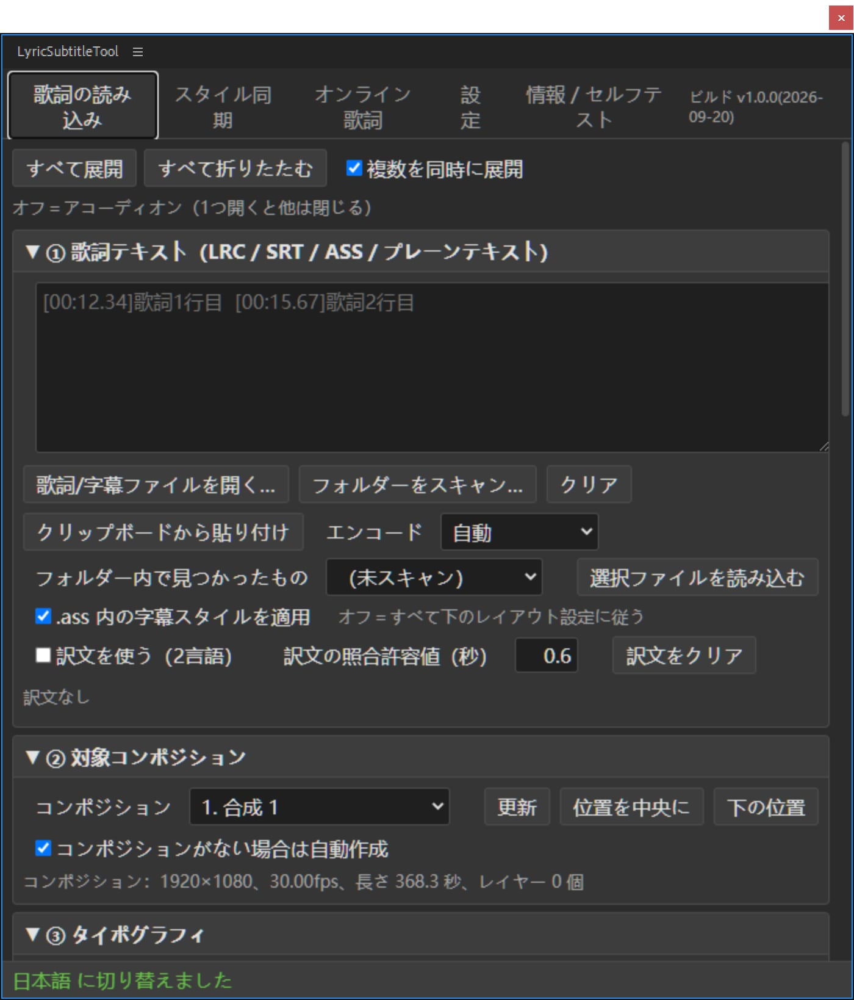

# 歌詞字幕レイアウトツール · LyricSubtitleTool

[English](README.md) ｜ [简体中文](README_SC.md) ｜ [繁體中文](README_TC.md) ｜ [日本語](README_JP.md)

LRC / SRT / ASS / VTT / プレーンテキストの歌詞を、**After Effects の文字レイヤーとして一括生成**、
または **Premiere Pro のキャプショントラック**として一度に並べます。

<p align="center">
    <a href="LICENSE"></a>
    <a href=""></a>
    <a href=""></a>
    <a href=""></a>
</p>


---

## できること

**After Effects**

| 機能 | 内容 |
| --- | --- |
| 字幕の一括配置 | `.lrc` / `.srt` / `.ass` / `.vtt` を読み込み、タイムコードどおりにコンポジション内へ字幕レイヤーを生成。イン点・アウト点も合わせ済み |
| 2言語字幕 | 原文と訳文を同じレイヤーに上下2行で入れることも、それぞれ別レイヤーに分けることも可能（分離時は行間を自動計算し、グループ全体を中央揃え） |
| スタイルの一括同期 | 手作業で1本作った字幕レイヤーのフォント / 境界線 / 位置 / アニメーション / キーフレーム / エクスプレッション / エフェクト / マスクを、数十〜数百レイヤーへ一括適用。`1-10` や `1,5,10` のようなレイヤー番号指定に対応 |
| 参照レイヤーから再構築 | 手作業の Ctrl+D + 文字の打ち直しに相当。参照レイヤー自体を複製し、各レイヤー元の文字とイン/アウト点を書き戻します |
| テンプレートレイヤー | 生成時に「これで良い」と思ったレイヤーをそのまま複製するので、スタイルが1文字もずれません |
| アニメーションプリセット | 内蔵の文字アニメーション数種に加え、AE 自身の `.ffx` も読み込めます |
| オンライン歌詞検索 | NetEase Cloud Music / QQ Music（訳文つき）。見つかればそのままパネルへ取り込めます |
| 縦組み / 自動中央揃え | AE 2024+ ではネイティブ縦組み、それ以前は自動フォールバック。テキストブロックの中心が指定した X/Y に厳密に一致します |

**Premiere Pro**

| 機能 | 内容 |
| --- | --- |
| 字幕トラック生成（推奨） | 歌詞 → `.srt` → 読み込み → PR ネイティブの字幕トラックを生成。速く、安定し、テンプレートも不要。生成後も「キャプション」パネルで1本ずつ編集できます |
| グラフィッククリップ | 停止中（理由は [FAQ](#faq) 参照） |

**対応フォーマット**：LRC（`[offset:]` や1行複数タイムコードを含む）、SRT、ASS / SSA（スタイル表ごと読み込み）、
WebVTT、プレーンテキスト（1行1字幕を固定尺で配置）。GBK / UTF-8 は自動判定、判定できない場合は手動で選択できます。

---

## インストール

> 対応：**After Effects CC 2018 〜 2025+**、**Premiere Pro 2019+**（字幕トラックは 2021+）。
> OS：**Windows / macOS**。Linux は非対応 —— Adobe は PR / AE の Linux 版を提供していません。

このプラグインは自己署名の拡張機能です。Adobe は既定で公式署名済みの拡張機能しか読み込まないため、
**CEP のデバッグモードを手動で有効にする必要があります**。有効にしないとパネルはメニューに現れず、
エラーも一切表示されません。以下の4ステップはすべて必須です。

### ステップ 1 拡張機能フォルダーをコピー

`LyricSubtitleTool_AE`（PR 版は `LyricSubtitleTool_PR`）の**フォルダーごと** CEP の拡張機能フォルダーへコピーします：

| | 拡張機能フォルダー |
| --- | --- |
| Windows | `C:\Users\<ユーザー名>\AppData\Roaming\Adobe\CEP\extensions\` |
| macOS | `~/Library/Application Support/Adobe/CEP/extensions/`（Finder で `Cmd+Shift+G` を押してパスを貼り付け） |

コピー後はこうなっているはずです：

```
.../Adobe/CEP/extensions/LyricSubtitleTool_AE/CSXS/manifest.xml
.../Adobe/CEP/extensions/LyricSubtitleTool_AE/client/index.html
.../Adobe/CEP/extensions/LyricSubtitleTool_AE/host/index.jsx
```

⚠ `LyricSubtitleTool_AE` というフォルダー自体が `extensions` の直下にある必要があります。
中のファイルを `extensions` へ直接ばらまかないでください。

### ステップ 2 デバッグモードを登録

**Windows**（どちらか一方）

- 同梱の `Add Keys.reg` をダブルクリックし、確認ダイアログで「はい」を選択
- または手動：`regedit` → `HKEY_CURRENT_USER\Software\Adobe\CSXS.11` →
  文字列値 `PlayerDebugMode` を新規作成し、値に `1` を設定

**macOS**（レジストリはなく、plist に書き込みます）

「ターミナル」を開いて貼り付け実行。PC の再起動は不要です：

```bash
for v in 9 10 11 12 13 14; do
  defaults write com.adobe.CSXS.$v PlayerDebugMode 1
done
```

> 古いバージョンのホストは `CSXS.11` を認識しないことがあるため、どちらの方法も 9〜14 をまとめて書き込みます。
> どれが必要か悩む必要はありません。

### ステップ 3 ホストを再起動

After Effects / Premiere Pro を**完全に終了**してから起動し直します。
CEP はプロセス起動時に一度だけ拡張機能フォルダーを走査するので、再起動しないとパネルは現れません。

### ステップ 4 パネルを開く

- AE：メニュー `ウィンドウ > エクステンション > LyricSubtitleTool`
- PR：メニュー `ウィンドウ > エクステンション > LyricSubtitleTool PR`

> このメニュー項目は常に英語で、**パネルの言語には追従しません** —— manifest 由来で、
> ホストがプロセス起動時に読むため、その時点ではパネルもスクリプトもまだ動いていません。
> パネル**内部**の見出しは言語設定に追従します。

### インストールしてもパネルが出ない？

この順に確認してください：

1. ホストを**完全に終了**してから起動し直したか
2. デバッグモードが本当に書き込まれたか（Windows は `regedit` で値を確認、macOS は
   `defaults read com.adobe.CSXS.11 PlayerDebugMode`）
3. フォルダー構造が正しいか —— `extensions\LyricSubtitleTool_AE\CSXS\manifest.xml` である必要があります
4. それでもだめならログを確認：
   `%TEMP%\CEP11-AEFT.log` / `%TEMP%\CEP11-PPRO.log`（macOS は `~/Library/Logs/CSXS/`）。
   中に `DevTools listening on ws://…` があればパネル自体は読み込めており、問題はパネル内部にあります

### AE のもうひとつの形：ScriptUI 単一スクリプト版

CEP パネルが読み込めないときの代替手段です。機能は同じですが、UI は旧来の ExtendScript ウィジェット（スクロールバーなし）です。

次の2つをセットで AE のスクリプトパネルフォルダーへコピーします：

```
歌词字幕排版工具.jsx     ← エントリ bootstrap。ScriptUI Panels 直下に置くこと
lyric_modules/           ← 各モジュール .jsx を格納したフォルダー
```

| | ScriptUI Panels フォルダー |
| --- | --- |
| Windows | `<AE インストール先>\Support Files\Scripts\ScriptUI Panels\` |
| macOS | `~/Library/Application Support/Adobe/After Effects <バージョン>/Scripts/ScriptUI Panels/`（ここなら管理者権限は不要） |

コピーするのはこの2つだけです。`lyric_modules` の中の `.jsx` を単体でコピー**しないでください**。
AE がそれぞれを独立したパネルとして「ウィンドウ」メニューに十数個並べてしまいます。
AE 再起動後のメニューは `ウィンドウ > 歌詞字幕排版工具` です。

> ExtendScript の単一コンパイル単位には約 107KB の上限があるため、プラグインは bootstrap + 小さなモジュール群に分割され、
> 実行時に bootstrap が `$.evalFile` で順に読み込みます。そのため `lyric_modules` は bootstrap と同じフォルダーに置く必要があります。
> 中国語パスが読めない環境では、同じフォルダーの `LyricSubtitleTool_AE.jsx`（内容は同一、ファイル名が ASCII）を使ってください。

---

## 5分でわかるクイックスタート（1曲を2言語字幕にする）

1. **まず満足できる字幕を1本手作業で作る** —— テキストレイヤーを新規作成し、フォント・サイズ・境界線・位置をお好みに調整。
   このレイヤーが後の「テンプレート」になります。
2. パネルを開く →「歌詞の読み込み」タブ → ①「歌詞 / 字幕ファイルを開く…」で `.lrc` / `.srt` / `.ass` を選択
   （文字化けしたら「エンコード」を GBK にして読み直し）
3. ② 対象コンポジション：コンポジションを選択（未選択なら「コンポジションがなければ自動作成」にチェック）
4. ④ タイムラインと2言語：`2言語レイヤー = 原文 / 訳文を別レイヤーに` を選び、行間は `0` のままでサイズ × 1.25
5. ⑤ テンプレートレイヤー：「選択レイヤーを使用」で手順1のレイヤーを指定
6. ⑥「字幕レイヤーを生成」をクリック

全体がずれた場合は再生成不要です。「全体オフセット / 追加ディレイ / 早めに終了」を調整してもう一度実行してください。

PR 版：流れは同じで、最後に「出力と生成」タブで「字幕トラックを生成」をクリックします。

---

## 機能詳細

パネル上部がタブです。以下タブごとに説明します。各タブ内の `①②③…` は折りたたみブロックで、
見出しをクリックすると開閉します。右上で「複数同時に展開」に切り替えられます。

### AE 版

#### 歌詞の読み込み

| ブロック | 内容 |
| --- | --- |
| ① 歌詞テキスト | 大きなテキスト欄に直接貼り付け。「歌詞 / 字幕ファイルを開く…」でファイル選択。「フォルダーを走査…」でディレクトリ内の字幕ファイルを一覧化し、選んで「選択ファイルを読み込む」。「クリップボードから貼り付け」。「エンコード」ドロップダウン（自動 / UTF-8 / GBK / GB2312…、文字化けはここで解決）<br>**.ass の字幕スタイルを適用**：ASS / SSA のみ有効。チェック時はファイルの `[V4+ Styles]` にあるフォント・サイズ・色・境界線を使用し、チェックを外すと下の「③ タイポグラフィ」に従います<br>**訳文を使用（2言語）**：チェックすると訳文を別テキストとして扱い、「訳文の対応許容差(秒)」でタイムコードによりペアリング |
| ② 対象コンポジション | コンポジションを選択。「中央 / 下寄せ」で現在の X/Y をコンポジション中央またはやや下に一発入力。未選択時は「コンポジションがなければ自動作成」で自動生成 |
| ③ タイポグラフィ | フォント、サイズ、トラッキング、横組み行間倍率（0 = サイズ × 1.25）、縦組み行間倍率、塗り色、境界線のオン/オフ + 色 + 幅、揃え（中央/左/右）、**縦組みテキスト**（右から左 / 左から右）、字幕中心 X/Y、**バウンディングボックスで自動中央揃え**（長い行も短い行も厳密に中央。チェック推奨）、レイヤー名の規則（歌詞テキスト / 連番 / 連番+歌詞）、レイヤーカラーラベル |
| ④ タイムラインと2言語 | タイムコードがない場合の既定尺、隣接行の間隔、最短/最長尺、**全体オフセット**（曲全体を平行移動）、追加ディレイ、早めに終了、同一タイムコードの判定許容差<br>2言語部分：レイアウト（上下2行 / 同じ行）、順序（原文が上 / 訳文が上）、**2言語レイヤー**（1レイヤーに統合 / 原文と訳文を別レイヤー）、2言語の行間（0 = 自動）、「同一タイムコードの各行を個別レイヤーにする」（2言語に限らず）、生成後にプリコンポーズへまとめる |
| ⑤ テンプレートレイヤー | タイムライン上の既存テキストレイヤーをドロップダウンからテンプレートに指定（「選択レイヤーを使用」で現在の選択を取得）。「生成後にテンプレートレイヤーを隠す」。「レイヤー名を歌詞に変更」。**テンプレートから生成した各レイヤーはそのレイヤーの複製品なので、スタイルは1文字もずれません** |
| ⑥ プレビューと生成 | 「プレビュー」で解析結果（タイムコード・原文・訳文）を先に確認。「逆順で読み込む」で最後の行を最上部に。「字幕レイヤーを生成」で実行 |
| ⑦ アニメーションプリセット | 内蔵の文字アニメーション数種 + AE 自身の `.ffx` を読み込み可能。「選択レイヤーに適用」/「このコンポジションの全テキストレイヤーに適用」。「適用前に既存のアニメーターを消す」。「字幕生成時に自動適用」。「プリセットフォルダー…」で独自ディレクトリを追加。「機能チェック」で現在の AE が対応するアニメーター属性を確認 |

> 全体のタイミングがずれても再生成は不要です。「全体オフセット / 追加ディレイ / 早めに終了」を調整して、
> もう一度生成を押すだけです。

#### スタイル同期

「1本を手で整えたら、残り数十本を一括で追従させる」ための機能です。

| ブロック | 内容 |
| --- | --- |
| ① 参照レイヤー | 参照レイヤーを選択（「現在の選択レイヤーを取得」）。⚠ **「レイヤースタイル」（ドロップシャドウ / 境界線 / 外側グロー / ベベル）は引き継げません** —— AE のスクリプト API が公開していないためです。一緒に移したい場合は `.ffx` を使用（下の「注意事項」参照） |
| ② 適用先レイヤー | レイヤー番号は `1-10`、`1,5,10`、`1-3,7,9-11` に対応。「テキストレイヤーのみ処理」。「参照レイヤー自身を除外」 |
| ③ 2言語レイヤー | 原文 / 訳文が対になる場合に使用：「もう一方の組」が使う参照レイヤーを指定。範囲（すべて / 参照レイヤーと同じ組のみ / もう一方の組のみ）。**2言語の位置**（参照レイヤーをそのままコピー＝2組が重なる / 上下のずれを保持＝推奨 / まったく動かさない）。行間。「グルーピングを走査」でペアリングの認識を確認 |
| ④ コピーする内容 | テキストスタイル、テキスト内容も上書き（既定はオフで各レイヤーの歌詞を保持）、トランスフォーム属性、レイヤー属性（ブレンドモード / 3D / モーションブラー / ラベル色）、キーフレーム、イージングと補間曲線、キーフレームがない場合の静的値コピー、エクスプレッション、エフェクト（エフェクトスタック全体）、マスク、テキストアニメーター<br>**キーフレームの調整**：各レイヤーのイン/アウト点に合わせてスケール（推奨）/ 全体を平行移動して元のリズムを保つ / 処理しない（絶対時間を維持） |

3つの実行ボタンの違い：

| ボタン | 動作 | 使いどころ |
| --- | --- | --- |
| 対象レイヤーに適用 | 参照レイヤーの属性を**1つずつ深くコピー**して対象レイヤーへ。テキスト内容は変更しない | レイヤーは既に生成済みで、見た目だけ揃えたい |
| 参照レイヤーから再構築 | 参照レイヤー自体を複製（AE 内部の複製なのでスタイル / エフェクト / アニメーター / マスクもすべて付随）し、各レイヤー元の文字とイン/アウト点を書き戻してから旧レイヤーを削除 | 手作業の Ctrl+D + 打ち直しに相当。スタイルが最もずれにくい |
| テキストスタイルのみ同期 | 最も軽量。フォント / サイズ / 色 / 境界線 / 行間 / トラッキング / 揃えだけを変更 | フォントだけ揃えたい、他は触りたくない |

> ⚠ 「参照レイヤーから再構築」は**元のレイヤーを削除します**（操作全体が1回の取り消しにまとまるので Ctrl+Z で戻せます）。
> 実行前にプロジェクトを保存してください。

#### オンライン歌詞

プラットフォーム（NetEase Cloud Music / QQ Music）→ キーワード（曲名・アーティスト・曲のリンク・曲 ID のいずれでも可）→「検索」→
結果一覧から選択 →「歌詞を取得（訳文つき）」→「歌詞の読み込みタブへ送る」。
ネット接続が必要です。歌詞は公開 API 由来で、正確性と著作権は各プラットフォームおよび作詞・作曲者に帰属します。
個人の学習・研究目的での利用を想定しています。

#### 設定

- **UI 言語**：簡体字中国語 / 繁体字中国語 / English / 日本語 / システムに従う。パネルとスクリプトのメッセージのみに影響し、
  AE 本体の UI は変わりません。変更は即時反映されます。
- **バージョン情報**：現在のビルド番号（リリース日時のタイムスタンプ）+ プラグインの場所 + 「拡張機能フォルダーを開く」。
- **パネル設定**：CEP のブラウザーローカルストレージに保存され、**.aep プロジェクトには書き込まれません**。
  「既定値に戻す」で一括リセットできます。

#### 情報 / セルフテスト

「セルフテストを実行」でホストの読み込み状態・AE バージョン・機能検出の結果を下の欄に出力します。
「オンライン経路チェック（実際に1回検索します）」でネットワーク経路が通るかを検証します。
問題が起きたときは、この2つの出力を貼ってもらうのが一番早い解決法です。

### PR 版

#### 歌詞の読み込み

ブロックは AE 版と完全には対応していません：

| PR 版 | 対応する AE 版 | 説明 |
| --- | --- | --- |
| ① 歌詞テキスト | ① 歌詞テキスト | 完全に同じ（貼り付け / ファイル選択 / フォルダー走査 / クリップボード / エンコード / ASS スタイル / 訳文ペアリング） |
| ② 対象シーケンス（タイムライン） | ② 対象コンポジション | コンポジションの代わりにシーケンスを選択 |
| ③ タイムラインと2言語 | ④ タイムラインと2言語 | 「2言語レイヤー / 2言語の行間 / 各行を個別レイヤー / プリコンポーズにまとめる」はなし —— 字幕トラックは元々1本ずつの積み重ねだから |
| ④ プレビュー | ⑥ プレビューと生成 | プレビューのみ。生成は「出力と生成」タブ |

**「タイポグラフィ」ブロックはありません** —— PR の字幕トラックの見た目は PR 自身の「キャプションスタイル」が決めるもので、
スクリプトからは変更できません。
見た目を揃えるには：生成後に「キャプション」パネルで一度設定すれば、トラック全体が追従します。

> PR のタイムラインは 0 秒から始まります。動画内の音楽に合わせる場合は、「全体オフセット」を音楽の開始位置に設定してください。

#### 出力と生成

| ボタン | 動作 |
| --- | --- |
| 字幕トラックを生成 | 解析結果を `.srt` に書き出し → プロジェクトパネルの「歌詞字幕ツール」ビンへ読み込み → PR の字幕トラック作成 API を呼び出し |
| SRT ファイルだけ書き出す… | ファイルのみ。タイムラインは変更しない（他用途に使う / 自分で読み込む） |
| 既存の字幕トラックを見る | シーケンス上の既存字幕トラックと本数を一覧表示 |

「2言語の原文と訳文を1つの字幕にまとめる」にチェックすると、原文と訳文が同じ字幕（2行）に入ります。
チェックを外すとそれぞれ別の字幕になります。

> 生成後に位置がずれた場合は、字幕トラック全体をドラッグするか、個々の字幕のイン/アウト点を変更してください。
> PR はスクリプトによる字幕トラックの削除を許可していません。重複生成で増えた分は右クリックで削除してください。

#### オンライン歌詞 / 設定 / 情報 · セルフテスト

AE 版と同じです。

---

## 注意事項

1. **インストール後は必ずホストを「完全に終了」してから再起動**。ウィンドウを閉じるだけでは不十分です ——
   CEP 拡張機能もスクリプトエンジンもプロセス起動時に読み込まれます。
2. **「参照レイヤーから再構築」は元のレイヤーを削除します**。操作全体が1回の取り消しにまとまるので Ctrl+Z で戻せますが、
   その後さらに別の編集をすると取り消しが複雑になります —— 実行前にプロジェクトを保存してください。
3. **レイヤースタイル（ドロップシャドウ / 境界線 / 外側グロー / ベベルとエンボス）は同期できません**。
   AE のスクリプト API が公開していないためです。
   一緒に移したい場合：参照レイヤーを選択 → メニュー「アニメーション > アニメーションプリセットを保存」で `.ffx` として保存
   → 「歌詞の読み込み」タブの ⑦ でそれを選んで適用。
   境界線だけなら「テキストプロパティ → 境界線」または「エフェクト → 生成 → 境界線」は同期できます。
4. **縦組みテキストにはバージョン要件があります**。AE 2024（24.2）以降はネイティブ縦組み、
   それ以前は「1文字ずつ改行」する模擬方式へ自動フォールバックします。使えますがネイティブほど精細ではなく、
   約物の位置が多少異なる場合があります。
5. **長時間の処理中はパネルが「固まった」ように見えます**。生成 / 同期 / 検索はいずれも同期ブロッキングで、
   スクリプト実行中はパネルが反応しません。これはホストとの通信方式によるもので、フリーズではありません。
   進捗はパネル下部のステータスバーで確認し、連打しないでください。
6. **オンライン歌詞は NetEase Cloud Music と QQ Music の2プラットフォームのみ**で、ネット接続が必要です。
   歌詞は公開 API 由来で、内容の正確性と著作権は各プラットフォームおよび作詞・作曲者に帰属します。
   個人の学習・研究目的にのみ使用してください。
7. **パネル設定はプロジェクトに付いてきません**。UI 設定（言語を含む）は CEP のブラウザーローカルストレージに保存され、
   `.aep` / `.prproj` には書き込まれません。別のマシンでは設定し直しが必要です。

---

## アンインストール

### AE / PR の CEP パネル版

**ステップ 1 ホストを終了**（AE / PR を完全に終了。ウィンドウを閉じるだけでは不可）。

**ステップ 2 拡張機能フォルダーを丸ごと削除**：

| | 削除するフォルダー |
| --- | --- |
| Windows | `C:\Users\<ユーザー名>\AppData\Roaming\Adobe\CEP\extensions\LyricSubtitleTool_AE`<br>（PR 版は `LyricSubtitleTool_PR`） |
| macOS | `~/Library/Application Support/Adobe/CEP/extensions/LyricSubtitleTool_AE`<br>（Finder で `Cmd+Shift+G` を押してパスを貼り付け） |

> スタートメニューで `%APPDATA%` を検索して Enter、`Adobe\CEP\extensions\` を開けば見つかります。
> フォルダーを消せば十分です。インストーラーもサービスもスタートアップ項目もありません。

**ステップ 3（任意）デバッグモードをオフにする。**
このプラグインは自己署名の拡張機能で、`PlayerDebugMode` があるから読み込まれます。不要なら削除できます：

```bash
# Windows：regedit → HKEY_CURRENT_USER\Software\Adobe\CSXS.11 → PlayerDebugMode を削除
# macOS：
for v in 9 10 11 12 13 14; do
  defaults delete com.adobe.CSXS.$v PlayerDebugMode 2>/dev/null
done
```

⚠ 削除すると**他に自分で入れた未署名の拡張機能もすべて動かなくなります**（今後入れたい同種のプラグインも含む）。
このプラグインだけを外したいなら、ステップ 2 で十分です。デバッグモードを残しても害はありません。

**ステップ 4 ホストを再起動**すれば、メニューの項目は消えます。

**パネルが残した設定**：拡張機能フォルダーと一緒に到達不能になります（その拡張機能のローカルストレージにあるため）。
明示的に消したい場合は、アンインストール前に「設定」タブで「既定値に戻す」を押してください。

### AE の ScriptUI 単一スクリプト版

次の2つを削除して、AE を再起動します：

```
<ScriptUI Panels フォルダー>\歌词字幕排版工具.jsx
<ScriptUI Panels フォルダー>\lyric_modules\          ← フォルダーごと
```

ASCII ファイル名を使った場合は `LyricSubtitleTool_AE.jsx` を削除します。
この2つだけを削除してください。ScriptUI Panels フォルダーを空にしないでください —— AE 標準のスクリプトも入っています。

---

## FAQ

**歌詞が文字化けする？**
パネルで「エンコード」を GBK に変更して読み直してください（古い LRC はほぼ GBK です）。

**PR で生成した字幕のスタイルがおかしい？**
字幕トラックの見た目は PR の「キャプションスタイル」が決めるもので、ExtendScript には字幕スタイルを書く **API がありません**。
「キャプション」パネルで一度設定すれば、トラック全体が追従します。

**PR で何度も生成したら字幕トラックが複数できた？**
PR はスクリプトによる字幕トラックの削除を許可していません。余分なものは右クリックで削除してください。

**PR の「グラフィッククリップ」はなぜ停止した？**
PR 自身が書き出した `.mogrt` の内部形式は `prgraphic` で、テキストパラメーター（`TextLayer`）をスクリプトから書き込めません ——
クリップは挿入され、本数も合い、`setValue` もエラーを出さないのに、画面上は永遠にテンプレートのプレースホルダーのままです。
変更できるのは AE から書き出した `aegraphic` テンプレート（テキストパラメーター名が `Text`）だけです。
独自スタイルが必要な場合の正解は**AE でテンプレートを作る**こと：スタイルを整える → エッセンシャルグラフィックスパネル → モーショングラフィックステンプレートを書き出す。

**Linux で使える？**
使えません。Adobe は Premiere Pro / After Effects の Linux 版を提供していません。

**コードを変更した後はどうインストールする？**
下の「ソースからビルド」を参照してください。

---

## ソースからビルド（開発用）

**Python 3.8+**（標準ライブラリのみ、サードパーティ製パッケージ不要）と **Node.js**（テスト実行のみ）が必要です。

```bash
python _tools/build_AEJSX.py      # ScriptUI 単一スクリプト版 → AE_JSX/
python _tools/build_AECEP.py      # AE CEP 版 → AE_CEP/dist/LyricSubtitleTool_AE/
python _tools/build_PRCEP.py      # PR CEP 版 → PR_CEP/dist/LyricSubtitleTool_PR/
```

3つとも `install` を付けられ、ビルド後に CEP 拡張機能フォルダーへ直接インストールします
（Windows はレジストリ、macOS は `defaults write` でデバッグモードを有効化）：

```bash
python _tools/build_AECEP.py install
python _tools/build_PRCEP.py install --no-reg    # インストールのみ、デバッグモードは触らない
```

ビルド時に以下の検査を実行し、1つでも通らなければ中断します。**壊れた生成物がホストへインストールされることはありません**：
ES3 構文（acorn）、正規表現内の裸のスラッシュ、UTF-8 BOM、単一コンパイル単位 104KB（107000 バイト）上限、
manifest XML の解析可否、フロントエンドのコントロール ID の突き合わせ、モジュール一覧の整合性。

> ES3 の厳密チェック（acorn）には追加ファイルが必要です：`python _tools/fetch_acorn.py`。
> ダウンロードしなくてもビルドはできますが、その項目は「スキップ」と表示されます ——
> ローカルで全チェックを回したい場合は一度このコマンドを実行してください（CI では自動でダウンロードされます）。

**`dist/` には拡張機能そのものだけを入れます**：`client/`、`CSXS/`、`host/`、`.debug` の4つ。
このフォルダーを CEP の `extensions` ディレクトリへ丸ごとドラッグすれば使えます。
説明書（`README_*.html` + `image/`）と `Add Keys.reg` は**拡張機能フォルダーには入れません** ——
これらは下のコマンドが作るリリースフォルダーの担当で、ユーザーが実際に目にするのはそちらです。

**リリース用パッケージ**：`python _tools/package_release.py` は2つの `dist/` を1つの
バージョンフォルダー `release/LyricSubtitleTool_v<バージョン>/` にまとめます。中身は
`LyricSubtitleTool_AE/`、`LyricSubtitleTool_PR/`、`Add Keys.reg`、4つの `README_*.html`、
`image/` です。バージョン番号は `00_header.jsx` から取得（manifest に書かれるものと同じ）で、
毎回フォルダーを空にしてから作り直すため前回の残骸は残りません。
**スクリプトは zip を作りません** —— バージョンフォルダーを右クリック →「ZIP ファイルに圧縮」。
（`LyricSubtitleTool_AE` だけを圧縮すると説明書と reg が抜けます。）

---

## リポジトリ構成

```
AE_JSX/     ScriptUI 版のソース（src/）とビルド生成物（歌词字幕排版工具.jsx + lyric_modules/）
AE_CEP/     AE の CEP 版：client/ フロントエンド + host/ ブリッジ → dist/ がそのままインストール可能な完成品
PR_CEP/     PR の CEP 版：client/ + host/{10_pr_seq,11_pr_caption,12_pr_graphics}
tests/      ユニットテスト（Node / Python、AE / PR 不要）+ ae/ 実機セルフテスト + probes/ 使い捨てプローブ
_tools/     ビルド、インストール、i18n、テンプレート走査などのスクリプト
docs/       開発ドキュメント、AE スクリプト入門、2言語の設計メモ、診断レポート。README_*.html はリリースフォルダーのルートへ
```

3つのパネルは同一のロジック層（解析 / エンコード / 多言語 / オンライン歌詞）を共有し、
ホスト適配層と UI 層だけが異なります。

---

## テスト

```bash
node tests/test_logic.js      # 123 項目  解析 / エンコード / タイムライン / レイヤー番号
node tests/test_pr.js         # 220 項目  PR ホスト：時間換算 / 字幕トラック / サイレント失敗 / テキスト書き込み
node tests/test_net.js        # 43 項目   パネル側ネットワーク層 + .mogrt の読み込み
node tests/test_i18n.js       # 54 項目   4言語の key 集合の一致
python tests/test_atguard.py  # エクスプレッション注入の防御
python tests/test_platform.py # クロスプラットフォーム：CEP 拡張機能フォルダー / AE スクリプトフォルダー / デバッグモード分岐
```

いずれも AE / PR の起動は不要です。実機セルフテストは `tests/ae/` にあり、
`python _tools/run_ae_selftest.py` で AE を起動して実行します。

CI（`.github/workflows/tests.yml`）は **Ubuntu / Windows / macOS** の3システムでビルドを1回ずつ実行します ——
生成物自体はクロスプラットフォームですが、「どこへインストールするか」「どうデバッグモードを有効にするか」は
まったく別のコード経路で、Linux だけで回すと macOS 側は永遠に検証されません。

多言語（簡体字 / 繁体字 / 英語 / 日本語）の取り決め：**中国語の原文がそのまま key** です。
文言を変えるときは `_tools/i18n/*.json` を同期して変更し、`python _tools/build_i18n.py` を実行してください。
詳細は [`docs/开发文档.md`](docs/开发文档.md) を参照。

---

## 既知の制限

- PR のキャプションスタイルとキャプションテキストには**スクリプト用の読み書き API がありません**（Adobe 未提供）
- 「キャプションをグラフィックにアップグレード」は UI 専用機能で API はありません
- PR は SVG を直接読み込めません。PNG を経由してください
- AE の ScriptUI では縦スクロールするコンテナを作れません（CEP 版が存在する理由）
- ExtendScript の単一コンパイル単位は約 104KB（107000 バイト）上限のため、モジュール分割が必須
  （言語表は言語ごとに a/b の2分割済み）

---

## ライセンス

[MIT](LICENSE)
