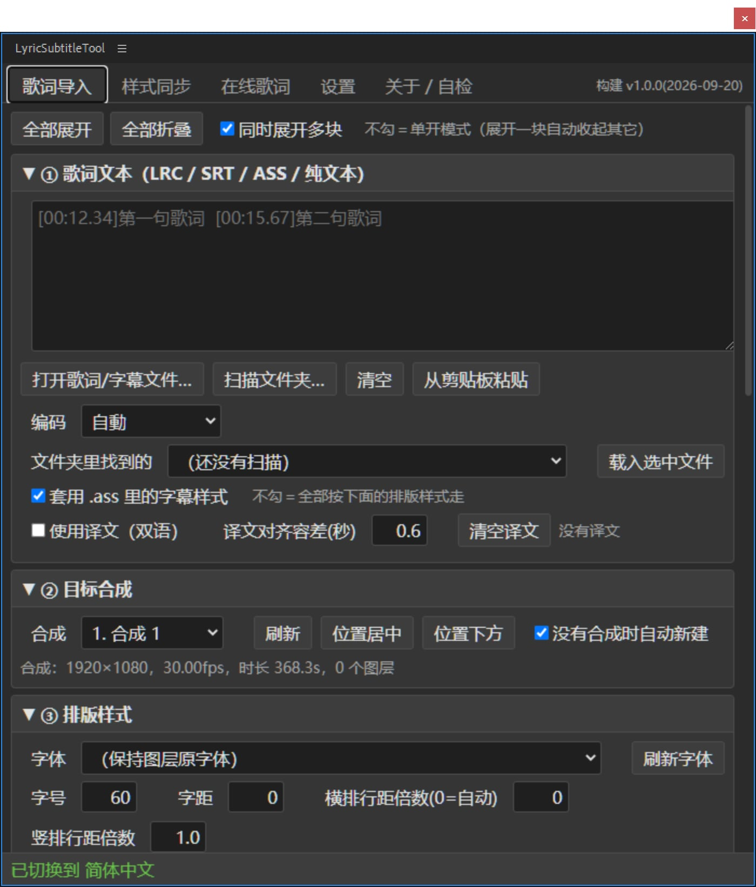

# 歌词字幕排版工具 · LyricSubtitleTool

[English](README.md) ｜ [简体中文](README_SC.md) ｜ [繁體中文](README_TC.md) ｜ [日本語](README_JP.md)

把 LRC / SRT / ASS / VTT / 纯文本歌词，一次性排成 **After Effects 的批量文字图层**，
或者 **Premiere Pro 的字幕轨道**。

<p align="center">
    <a href="LICENSE"></a>
    <a href=""></a>
    <a href=""></a>
    <a href=""></a>
</p>



---

## 能干什么

**After Effects**

| 功能 | 说明 |
| --- | --- |
| 批量排字幕 | 读一个 `.lrc` / `.srt` / `.ass` / `.vtt`，按时间码在合成里生成一个个字幕图层，入点出点全对好 |
| 双语字幕 | 原文 + 译文可以写进同一个图层（上下两行），也可以各占一个图层（拆层自动算行距、整组居中） |
| 样式批量同步 | 手动做好一个字幕图层，一键把字体 / 描边 / 位置 / 动画 / 关键帧 / 表达式 / 效果 / 蒙版套到几十上百层上，支持 `1-10`、`1,5,10` 这样按图层号指定 |
| 以参考图层重建 | 等价于手动 Ctrl+D 再改文字：复制参考图层本身，把每层原来的文字和入点出点写回去 |
| 模板图层 | 生成时直接复制你满意的那条图层，样式一个字都不会跑 |
| 动画预设 | 内置几套文字动画，也能读 AE 自己的 `.ffx` |
| 在线搜歌词 | 网易云音乐 / QQ 音乐，含译文，搜到就能带进面板 |
| 竖排 / 自动居中 | AE 2024+ 用原生竖排，更早版本自动降级；文字块中心严格落在你给的 X/Y |

**Premiere Pro**

| 功能 | 说明 |
| --- | --- |
| 生成字幕轨道（推荐） | 歌词 → `.srt` → 导入项目 → 建成 PR 原生字幕轨。快、稳、不吃模板，生成后还能在「字幕」面板里一条条改 |
| 图形剪辑 | 已关闭，原因见 [FAQ](#faq) |

**支持的格式**：LRC（含 `[offset:]`、一行多时间码）、SRT、ASS / SSA（连样式表一起读）、
WebVTT、纯文本（一行一句按固定时长排）。GBK / UTF-8 自动识别，认不出来可以手动选。

---

## 安装

> 兼容：**After Effects CC 2018 ~ 2025+**、**Premiere Pro 2019+**（字幕轨需要 2021+）。
> 系统：**Windows / macOS**。Linux 不支持 —— Adobe 没有 Linux 版的 PR / AE。

插件是自签名扩展，Adobe 默认只加载官方签名过的扩展，所以**必须手动打开 CEP 调试模式**，
否则面板根本不会出现在菜单里，而且没有任何提示。下面四步缺一不可。

### 第 1 步 复制扩展目录

把 `LyricSubtitleTool_AE`（PR 版是 `LyricSubtitleTool_PR`）
**整个文件夹**复制到 CEP 的扩展目录：

| | 扩展目录 |
| --- | --- |
| Windows | `C:\Users\<你的用户名>\AppData\Roaming\Adobe\CEP\extensions\` |
| macOS | `~/Library/Application Support/Adobe/CEP/extensions/`（Finder 里按 `Cmd+Shift+G` 粘路径） |

复制完之后应该是这样：

```
.../Adobe/CEP/extensions/LyricSubtitleTool_AE/CSXS/manifest.xml
.../Adobe/CEP/extensions/LyricSubtitleTool_AE/client/index.html
.../Adobe/CEP/extensions/LyricSubtitleTool_AE/host/index.jsx
```

⚠ 一定要让 `LyricSubtitleTool_AE` 这一层文件夹存在于 `extensions` 下面，
**不要**把里面的文件倒进 `extensions`。


### 第 2 步 注册调试模式

**Windows**（两种办法选一个）

- 双击随包附带的 `Add Keys.reg`，问是否继续就选「是」
- 或者手动：`regedit` → `HKEY_CURRENT_USER\Software\Adobe\CSXS.11` →
  新建字符串值 `PlayerDebugMode`，值填 `1`

**macOS**（没有注册表，写的是 plist）

打开「终端」粘贴执行，不需要重启电脑：

```bash
for v in 9 10 11 12 13 14; do
  defaults write com.adobe.CSXS.$v PlayerDebugMode 1
done
```

> 老版本宿主可能不认 `CSXS.11`，所以上面两种办法都是把 9~14 一次性全写，不用挑。

### 第 3 步 重启宿主

**完全退出** After Effects / Premiere Pro 再重新打开。
CEP 只在进程启动时扫一次扩展目录，不重启是看不到的。

### 第 4 步 打开面板

- AE：菜单 `窗口 > 扩展 > LyricSubtitleTool`
- PR：菜单 `窗口 > 扩展 > LyricSubtitleTool PR`

> 菜单里这一行固定是英文，**不会跟着面板语言变** —— 它来自 manifest，宿主在进程启动时读，
> 那时面板还没加载，脚本也还没跑。面板**内部**的标题会正常跟随语言设置。

### 装完看不到面板？

按顺序查：

1. 宿主是不是**完全退出**后重开的
2. 调试模式有没有真的写进去（Windows 打开 `regedit` 看一眼那个值；macOS 跑
   `defaults read com.adobe.CSXS.11 PlayerDebugMode`）
3. 扩展目录结构对不对 —— 必须是 `extensions\LyricSubtitleTool_AE\CSXS\manifest.xml`
4. 还是不行就看日志：
   `%TEMP%\CEP11-AEFT.log` / `%TEMP%\CEP11-PPRO.log`（macOS 在 `~/Library/Logs/CSXS/`），
   里面出现 `DevTools listening on ws://…` 说明面板加载成功，问题在面板内部

### AE 的另一种形态：ScriptUI 单脚本版

CEP 面板加载不了时的备用方案，功能一样，界面是老式 ExtendScript 控件（没有滚动条）。

把这两样一起复制到 AE 的脚本面板目录：

```
歌词字幕排版工具.jsx     ← 入口 bootstrap，必须直接放在 ScriptUI Panels 顶层
lyric_modules/           ← 文件夹，里面是各模块 .jsx
```

| | ScriptUI Panels 目录 |
| --- | --- |
| Windows | `<AE 安装目录>\Support Files\Scripts\ScriptUI Panels\` |
| macOS | `~/Library/Application Support/Adobe/After Effects <版本>/Scripts/ScriptUI Panels/`（放这里不用管理员权限） |

只能复制这两样，**不要**单独复制 `lyric_modules` 里面的 `.jsx`，否则它们会被 AE
当成十几个独立面板列进「窗口」菜单。重启 AE 后菜单：`窗口 > 歌词字幕排版工具`。

> 因为 ExtendScript 单个编译单元有 ~107KB 上限，插件被拆成 bootstrap + 一批小模块，
> 运行时由 bootstrap 用 `$.evalFile` 逐个加载，所以 `lyric_modules` 必须和 bootstrap 待在同一目录。
> 中文路径读不了的话，用同目录下的 `LyricSubtitleTool_AE.jsx`（内容一样，文件名是 ASCII）。

---

## 五分钟上手（给一首歌做中英双语字幕）

1. **先手动做一条满意的字幕** —— 新建文字图层，字体、字号、描边、位置调到你喜欢的样子。
   这条图层就是后面的「模板」。
2. 打开面板 →「歌词导入」页 → ① 点「打开歌词/字幕文件…」选中 `.lrc` / `.srt` / `.ass`
   （乱码就把「编码」改成 GBK 再读一次）
3. ② 目标合成：选一个合成（没选可以勾「没有合成时自动新建」）
4. ④ 时间轴与双语：`双语图层 = 原文 / 译文各占一个图层`，行距留 `0` = 字号 × 1.25
5. ⑤ 模板图层：点「用选中层」选中第 1 步那条图层
6. ⑥ 点「生成字幕图层」

时间整体偏了不用重新生成，调「整体偏移 / 额外延后 / 提前结束」再来一次即可。

PR 版：同样流程，最后在「输出与生成」页点「生成字幕轨」。

---

## 功能详解

面板顶部是标签页，下面按页说明。每一页里的 `①②③…` 是折叠块，点标题展开/收起，
右上角可以切成「同时展开多块」。

### AE 版

#### 歌词导入

| 折叠块 | 里面有什么 |
| --- | --- |
| ① 歌词文本 | 大文本框直接粘；「打开歌词/字幕文件…」选文件；「扫描文件夹…」把一个目录下的字幕文件都列进下拉框，选中再「载入选中文件」；「从剪贴板粘贴」；「编码」下拉（自动 / UTF-8 / GBK / GB2312…，乱码就改这里）<br>**套用 .ass 里的字幕样式**：只对 ASS / SSA 生效，勾着时用文件 `[V4+ Styles]` 里的字体、字号、颜色、描边，不勾就全按下面「③ 排版样式」走<br>**使用译文（双语）**：勾上后译文单独一份文本，靠「译文对齐容差(秒)」按时间码配对 |
| ② 目标合成 | 选一个合成；「位置居中 / 位置下方」把当前的 X/Y 一键填成合成中心或偏下；没选合成时勾「没有合成时自动新建」会自动建一个 |
| ③ 排版样式 | 字体、字号、字距、横排行距倍数（0 = 字号 × 1.25）、竖排行距倍数、填充色、描边开关 + 颜色 + 宽度、对齐（居中/左/右）、**竖排文字**（从右往左 / 从左往右）、字幕中心 X/Y、**按包围盒自动居中**（长短句都严格居中，建议勾）、图层名规则（歌词文本 / 序号 / 序号+歌词）、图层颜色标签 |
| ④ 时间轴与双语 | 无时间码时的默认时长、相邻两句的间隙、最短/最长时长、**整体偏移**（全曲平移）、额外延后、提前结束、同时间码判定容差<br>双语部分：排版（上下两行 / 同一行）、顺序（原文在上 / 译文在上）、**双语图层**（合并成一个图层 / 原文译文各占一个图层）、双语行距（0 = 自动）、「同一时间码的每行都单独建层」（不限双语）、生成后打包成预合成 |
| ⑤ 模板图层 | 下拉选一个时间线上已有的文字层当模板（「用选中层」直接取当前选中）；勾「生成后隐藏模板图层」；勾「图层名改成歌词」。**用模板生成出来的每一条都是那条图层的复制品，样式一个字都不会跑** |
| ⑥ 预览与生成 | 「预览解析结果」先看解析对不对（时间码、原文、译文）；「倒序导入」让最后一句排最上层；「生成字幕图层」开跑 |
| ⑦ 动画预设 | 内置几套文字动画 + 能读 AE 自己的 `.ffx`；「套到选中图层」/「套到本合成全部文字层」；「套用前清掉已有动画器」；「生成字幕时自动套用」；「预设文件夹…」加自己的预设目录；「能力体检」看当前 AE 支持哪些动画器属性 |

> 时间整体偏了不用重新生成：调「整体偏移 / 额外延后 / 提前结束」再点一次生成即可。

#### 样式同步

做一次「手动调好一条，剩下几十条一键跟上」的活。

| 折叠块 | 里面有什么 |
| --- | --- |
| ① 参考图层 | 选参考层（「获取当前选中图层」）。**「图层样式」（投影 / 描边 / 外发光 / 斜面）能跟着「以参考图层重建」一起搬走** —— 那是 AE 内部复制，不受脚本接口限制；只有逐属性同步那种做法抄不到它（见下方「注意事项」） |
| ② 应用到哪些图层 | 图层号支持 `1-10`、`1,5,10`、`1-3,7,9-11`；「只处理文字图层」；「跳过参考图层本身」 |
| ③ 双语图层 | 原文 / 译文成对时用：指定「另一组用」哪个参考层；范围（全部 / 只跟参考层同组 / 只另一组）；**双语位置**（照抄参考层＝两组会叠在一起 / 保留上下错位＝推荐 / 完全不动）；行距；「扫一遍分组」检查配对认得对不对 |
| ④ 复制哪些内容 | 文字样式、同时覆盖文本内容（默认不覆盖，保留各自歌词）、变换属性、图层属性（混合模式/3D/运动模糊/标签色）、关键帧、缓动与插值曲线、无关键帧时复制静态值、表达式、效果（整条特效栈）、蒙版、文字动画器<br>**关键帧校准**：缩放到每层的入点/出点（推荐）/ 整体平移保持原节奏 / 不处理（保留绝对时间） |

两个动作按钮的区别：

| 按钮 | 干了什么 | 什么时候用 |
| --- | --- | --- |
| 以参考图层重建 | 复制参考层本身（AE 内部复制，样式 / 效果 / 动画器 / 蒙版 / 图层样式全带），再把每层原来的文字和入出点写回去，最后删掉旧层；双语会按组内行号自动错位 | 等价于手动 Ctrl+D 再改字，样式最不容易跑偏 |
| 只同步文字样式 | 最轻量，只动字体 / 字号 / 颜色 / 描边 / 行距 / 字距 / 对齐 | 只想统一字体，其它别碰 |

> ⚠ 「以参考图层重建」**会删掉原图层**（整个操作在一步撤销里，Ctrl+Z 能回来）。
> 动手前先存工程。

> 旧版本还有一个「应用到目标图层」（把参考层属性逐个深拷贝到目标层、不删层），
> 已经**从面板隐藏**：它抄不走「图层样式」，做出来的字幕经常样式跟不上，效果明显不如重建。
> 代码仍然保留，需要非破坏性同步时可以放回来，方法见 `docs/开发文档.md`。

#### 在线歌词

平台（网易云音乐 / QQ 音乐）→ 关键词（歌名、歌手、歌曲链接、歌曲 ID 都行）→「搜索」→
在结果列表里挑 →「获取歌词（含译文）」→「载入歌词导入页」。
需要联网；歌词来自公开接口，准确性和版权归各平台与词曲作者，仅建议个人学习研究使用。

#### 设置

- **界面语言**：简体中文 / 繁体中文 / English / 日语 / 跟随系统。只影响面板和脚本提示，
  AE 自身界面不变；改完立刻生效。
- **版本信息**：当前构建号（发版时间戳）+ 插件所在路径 + 「打开插件文件夹」。
- **面板设置**：存在 CEP 的浏览器本地存储里，**不会写进 .aep 工程**；
  「恢复默认设置」一键清回默认。

#### 关于 / 自检

「运行自检」把宿主加载状态、AE 版本、能力探测结果打到下面的框里；
「在线通道体检（会真搜一次）」验证取网通道通不通。出问题时把这两段发出来最快。

### PR 版

#### 歌词导入

折叠块和 AE 版不完全对应：

| PR 版 | 对应 AE 版 | 说明 |
| --- | --- | --- |
| ① 歌词文本 | ① 歌词文本 | 完全一样（粘/选文件/扫文件夹/剪贴板/编码/ASS 样式/译文配对） |
| ② 目标序列（时间线） | ② 目标合成 | 换成选序列 |
| ③ 时间轴与双语 | ④ 时间轴与双语 | 少了「双语图层 / 双语行距 / 每行单独建层 / 打包预合成」—— 字幕轨本身就是一条一条的 |
| ④ 预览 | ⑥ 预览与生成 | 只留预览，生成在「输出与生成」页 |

**没有「排版样式」块** —— PR 字幕轨的样式由 PR 自己的「字幕样式」决定，脚本改不了。
要统一外观：生成后在「字幕」面板里设一次，整条轨跟着变。

> PR 的时间线从 0 秒起算。要对着视频里的音乐打轴，把「整体偏移」调成音乐起点即可。

#### 输出与生成

| 按钮 | 干什么 |
| --- | --- |
| 生成字幕轨 | 把解析结果写成 `.srt` → 导入项目面板的「歌词字幕工具」素材箱 → 调 PR 的建字幕轨接口 |
| 只导出 SRT 文件… | 只要文件，不动时间线（拿去别处用 / 自己再导） |
| 查看已有字幕轨 | 列出序列上现有的字幕轨和条数 |

「双语的原文和译文合成一条字幕」勾上时，原文和译文写进同一条字幕（两行）；
不勾则各占一条。

> 生成后位置不对，直接拖整条字幕轨、或改单条字幕的入出点即可。
> PR 不允许脚本删除字幕轨，重复生成多出来的右键删掉。

#### 在线歌词 / 设置 / 关于 · 自检

和 AE 版一致。

---

## 注意事项

1. **装完必须「完全退出」宿主再重启**。只关窗口不算 —— CEP 扩展和脚本引擎都是进程启动时加载的。
2. **「以参考图层重建」会删掉原图层**。整个操作在一步撤销里，Ctrl+Z 能撤回；
   但只要之后又做了别的编辑，撤销就变复杂了 —— 动手前先存工程。
3. **图层样式（投影 / 描边 / 外发光 / 斜面浮雕）只有「以参考图层重建」带得走**。
   它是 AE 内部的 `duplicate()`，不受脚本接口限制，所以这一块不用管。
   如果哪天要用回「逐属性同步」那条老路，那部分抄不到图层样式，只能走 `.ffx`：
   选中参考层 → 菜单「动画 > 将动画预设另存为」存成 `.ffx` → 去「歌词导入」页 ⑦ 选它套用。
   只是描边的话，「文字属性 → 描边」或「效果 → 生成 → 描边」这两样是能同步的。
4. **竖排文字有版本要求**。AE 2024（24.2）及以上走原生竖排；更早版本自动降级成
   「逐字换行」仿真方案，能用但不如原生精细，标点位置也可能略有差异。
5. **长任务期间宿主会「卡住」**。生成 / 同步 / 搜索都是同步阻塞的，脚本在跑时宿主点不动，
   这是宿主通讯机制决定的，不是死机。进度看面板底部状态栏（同步 / 重建会逐层显示 `3/10`），
   等它回来就行，别反复点。
6. **在线歌词只有网易云和 QQ 音乐两个平台**，需要联网。歌词来自公开接口，
   内容准确性和版权归各平台与词曲作者，请仅用于个人学习研究。
7. **面板设置不跟着工程走**。界面设置（含语言）存在 CEP 的浏览器本地存储里，
   不会写进 `.aep` / `.prproj`。换台机器要重设。

---

## 卸载

### AE / PR 的 CEP 面板版

**第 1 步 关掉宿主**（完全退出 AE / PR，不是关窗口）。

**第 2 步 删掉整个扩展文件夹**：

| | 要删的文件夹 |
| --- | --- |
| Windows | `C:\Users\<你的用户名>\AppData\Roaming\Adobe\CEP\extensions\LyricSubtitleTool_AE`<br>（PR 版是 `LyricSubtitleTool_PR`） |
| macOS | `~/Library/Application Support/Adobe/CEP/extensions/LyricSubtitleTool_AE`<br>（Finder 里按 `Cmd+Shift+G` 粘路径） |

> 开始菜单搜 `%APPDATA%` 回车，进 `Adobe\CEP\extensions\` 就能看到。
> 删文件夹就够了，没有安装程序、没有服务、没有开机启动项。

**第 3 步（可选）关掉调试模式。**
插件是自签名扩展，靠 `PlayerDebugMode` 才被加载。不想要了可以删掉：

```bash
# Windows：regedit → HKEY_CURRENT_USER\Software\Adobe\CSXS.11 → 删掉 PlayerDebugMode
# macOS：
for v in 9 10 11 12 13 14; do
  defaults delete com.adobe.CSXS.$v PlayerDebugMode 2>/dev/null
done
```

⚠ 删了之后**其它自己装的未签名扩展也会一起失效**（包括你以后想装的同类插件）。
只是想卸这个插件的话，第 2 步删完就够了，调试模式留着没坏处。

**第 4 步 重启宿主**，菜单里的入口就没了。

**面板留下的设置**：跟着扩展目录一起失效（存在那个扩展的本地存储里）。
想主动清干净，卸载前先在「设置」页点一下「恢复默认设置」。

### AE 的 ScriptUI 单脚本版

删掉这两样，再重启 AE：

```
<ScriptUI Panels 目录>\歌词字幕排版工具.jsx
<ScriptUI Panels 目录>\lyric_modules\          ← 整个文件夹
```

如果你当时用了 ASCII 文件名，删的是 `LyricSubtitleTool_AE.jsx`。
注意只删这两样，别把 ScriptUI Panels 目录整个清空 —— 里面还有 AE 自带的脚本。

---

## FAQ

**歌词读出来是乱码？**
面板上把「编码」改成 GBK 再读一次（老 LRC 文件基本都是 GBK）。

**PR 生成的字幕样式不对？**
字幕轨道的样式由 PR 的「字幕样式」决定，ExtendScript **没有**写字幕样式的 API。
在「字幕」面板里设一次，整条轨都跟着变。

**PR 重复生成出好几条字幕轨？**
PR 不允许脚本删除字幕轨，多余的右键删掉即可。

**PR 的「图形剪辑」为什么关了？**
PR 自己导出的 `.mogrt` 内部是 `prgraphic`，文字参数（`TextLayer`）脚本写不进去 ——
剪辑插进去了、条数也对、`setValue` 不报错，屏幕上却永远是模板占位符。
只有 AE 导出的 `aegraphic` 模板（文字参数叫 `Text`）才能改。
需要自定义样式时，正解是**用 AE 做模板**：调好样式 → 基本图形面板 → 导出动态图形模板。

**能在 Linux 上用吗？**
不能。Adobe 没有 Linux 版 Premiere Pro / After Effects。

**改代码后怎么装？**
见下面的「从源码构建」。

---

## 从源码构建（开发用）

需要 **Python 3.8+**（只用标准库，不装任何第三方包）和 **Node.js**（只跑测试用）。

```bash
python _tools/build_AEJSX.py      # ScriptUI 单脚本版 → AE_JSX/
python _tools/build_AECEP.py      # AE CEP 版 → AE_CEP/dist/LyricSubtitleTool_AE/
python _tools/build_PRCEP.py      # PR CEP 版 → PR_CEP/dist/LyricSubtitleTool_PR/
```

三个脚本都能加 `install`，构建完直接装到 CEP 扩展目录（Windows 写注册表、
macOS 用 `defaults write` 打开调试模式）：

```bash
python _tools/build_AECEP.py install
python _tools/build_PRCEP.py install --no-reg    # 只装，不动调试模式
```

构建会顺手做这些检查，任何一项不过就中断，**不会把坏产物装进宿主**：
ES3 语法（acorn）、正则里的裸斜杠、UTF-8 BOM、单编译单元 104KB（107000 字节）上限、
manifest XML 可解析、前端控件 id 交叉核对、模块清单一致性。

> ES3 严格校验（acorn）需要额外下载一个文件：`python _tools/fetch_acorn.py`。
> 没下载也能构建，只是这一项会打印「跳过」—— 本地想跑全检查就先跑一次这个命令
> （CI 里是自动下的）。

**`dist/` 里只放扩展本身**：`client/`、`CSXS/`、`host/`、`.debug` 四项，
整个文件夹拖进 CEP 的 `extensions` 目录就能用。说明文档（`README_*.html` + `image/`）和
`Add Keys.reg` **不进扩展目录** —— 它们归发版目录管，由下面这条命令放到用户真正会看的地方。

**打包发版**：`python _tools/package_release.py` 把两个 `dist/` 组装成一个版本目录
`release/LyricSubtitleTool_v<版本>/`，里面是 `LyricSubtitleTool_AE/`、`LyricSubtitleTool_PR/`
两个扩展文件夹，加上 `Add Keys.reg`、四份 `README_*.html` 和 `image/`。
版本号取自 `00_header.jsx`，和 manifest 里写的是同一个；每轮先清空版本目录再重建，
不会把上一版的残留文件带进来。**脚本不产 zip** —— 右键版本目录 → 压缩为 ZIP 文件即可。
（别只压 `LyricSubtitleTool_AE` 一个文件夹，那样说明文档和 reg 会丢。）

---

## 仓库结构

```
AE_JSX/     ScriptUI 版源码（src/）与构建产物（歌词字幕排版工具.jsx + lyric_modules/）
AE_CEP/     AE 的 CEP 版：client/ 前端 + host/ 桥接 → dist/ 是可直接安装的成品
PR_CEP/     PR 的 CEP 版：client/ + host/{10_pr_seq,11_pr_caption,12_pr_graphics}
tests/      单测（Node / Python 跑，不需要开 AE/PR）+ ae/ 真机自检 + probes/ 一次性探针
_tools/     构建、安装、i18n、模板扫描等脚本
docs/       开发文档、AE 脚本入门、双语方案、诊断报告；README_*.html 会进发版目录根
```

三套面板共用同一套逻辑层（解析 / 编码 / 多语言 / 在线歌词），只有宿主适配层和界面层不同。

---

## 测试

```bash
node tests/test_logic.js      # 123 项  解析 / 编码 / 时间轴 / 图层号
node tests/test_pr.js         # 220 项  PR 宿主：时间换算 / 字幕轨 / 静默失败 / 文字写入
node tests/test_net.js        # 43 项   面板取网层 + 读 .mogrt
node tests/test_i18n.js       # 54 项   四种语言的 key 集合一致性
python tests/test_atguard.py  # 表达式注入防护
python tests/test_platform.py # 跨平台：CEP 扩展目录 / AE 脚本目录 / 调试模式分支
```

都不需要开 AE / PR。真机自检在 `tests/ae/`，用 `python _tools/run_ae_selftest.py` 拉起 AE 跑。

CI（`.github/workflows/tests.yml`）在 **Ubuntu / Windows / macOS** 三个系统上各跑一遍构建 ——
产物本身是跨平台的，但「装到哪、怎么开调试模式」是两套完全不同的代码，
只在 Linux 上跑的话 macOS 那半边永远测不到。

多语言（中文 / 繁体 / 英文 / 日文）的约定：**中文原文就是 key**，
改文案就去 `_tools/i18n/*.json` 同步改，再 `python _tools/build_i18n.py`。
细节见 [`docs/开发文档.md`](docs/开发文档.md)。

---

## 已知限制

- PR 字幕样式、字幕文本都**没有**脚本读写 API（Adobe 没给）
- 「字幕升级为图形」是纯界面功能，没有 API
- PR 不能直接导入 SVG，要先用 PNG
- AE 的 ScriptUI 做不出垂直滚动容器（所以才有 CEP 版）
- ExtendScript 单编译单元约 104KB（107000 字节）上限，模块必须拆开
  （语言表已按语言拆成 a/b 两片）

---

## 许可

[MIT](LICENSE)
