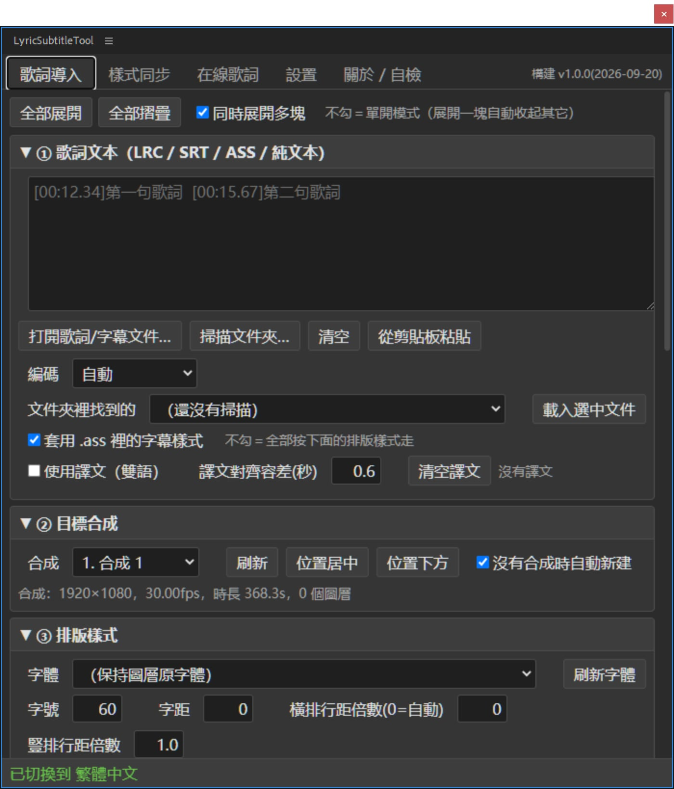

# 歌詞字幕排版工具 · LyricSubtitleTool

[English](README.md) ｜ [简体中文](README_SC.md) ｜ [繁體中文](README_TC.md) ｜ [日本語](README_JP.md)

把 LRC / SRT / ASS / VTT / 純文字歌詞，一次排成 **After Effects 的批次文字圖層**，
或者 **Premiere Pro 的字幕軌道**。

<p align="center">
    <a href="LICENSE"></a>
    <a href=""></a>
    <a href=""></a>
    <a href=""></a>
</p>


---

## 能做什麼

**After Effects**

| 功能 | 說明 |
| --- | --- |
| 批次排字幕 | 讀一個 `.lrc` / `.srt` / `.ass` / `.vtt`，依時間碼在合成裡生成一個個字幕圖層，入點出點全部對好 |
| 雙語字幕 | 原文 + 譯文可以寫進同一個圖層（上下兩行），也可以各佔一個圖層（拆層自動算行距、整組置中） |
| 樣式批次同步 | 手動做好一個字幕圖層，一鍵把字體 / 描邊 / 位置 / 動畫 / 關鍵影格 / 表達式 / 效果 / 遮罩套到幾十上百層上，支援 `1-10`、`1,5,10` 這樣依圖層編號指定 |
| 以參考圖層重建 | 等於手動 Ctrl+D 再改文字：複製參考圖層本身，把每層原來的文字和入點出點寫回去 |
| 模板圖層 | 生成時直接複製你滿意的那條圖層，樣式一個字都不會跑掉 |
| 動畫預設 | 內建幾套文字動畫，也能讀 AE 自己的 `.ffx` |
| 線上搜歌詞 | 網易雲音樂 / QQ 音樂，含譯文，搜到就能帶進面板 |
| 直排 / 自動置中 | AE 2024+ 用原生直排，更早版本自動降級；文字塊中心嚴格落在你給的 X/Y |

**Premiere Pro**

| 功能 | 說明 |
| --- | --- |
| 生成字幕軌（推薦） | 歌詞 → `.srt` → 匯入專案 → 建成 PR 原生字幕軌。快、穩、不吃模板，生成後還能在「字幕」面板裡一條條改 |
| 圖形剪輯 | 已關閉，原因見 [FAQ](#faq) |

**支援的格式**：LRC（含 `[offset:]`、一行多時間碼）、SRT、ASS / SSA（連樣式表一起讀）、
WebVTT、純文字（一行一句依固定時長排）。GBK / UTF-8 自動辨識，認不出來可以手動選。

---

## 安裝

> 相容：**After Effects CC 2018 ~ 2025+**、**Premiere Pro 2019+**（字幕軌需要 2021+）。
> 系統：**Windows / macOS**。不支援 Linux —— Adobe 沒有 Linux 版的 PR / AE。

外掛是自簽章擴充功能，Adobe 預設只載入官方簽章過的擴充功能，所以**必須手動開啟 CEP 除錯模式**，
否則面板根本不會出現在選單裡，而且沒有任何提示。下面四步缺一不可。

### 第 1 步 複製擴充功能目錄

把 `LyricSubtitleTool_AE`（PR 版是 `LyricSubtitleTool_PR`）
**整個資料夾**複製到 CEP 的擴充功能目錄：

| | 擴充功能目錄 |
| --- | --- |
| Windows | `C:\Users\<你的使用者名稱>\AppData\Roaming\Adobe\CEP\extensions\` |
| macOS | `~/Library/Application Support/Adobe/CEP/extensions/`（Finder 裡按 `Cmd+Shift+G` 貼路徑） |

複製完之後應該是這樣：

```
.../Adobe/CEP/extensions/LyricSubtitleTool_AE/CSXS/manifest.xml
.../Adobe/CEP/extensions/LyricSubtitleTool_AE/client/index.html
.../Adobe/CEP/extensions/LyricSubtitleTool_AE/host/index.jsx
```

⚠ 一定要讓 `LyricSubtitleTool_AE` 這一層資料夾存在於 `extensions` 下面，
**不要**把裡面的檔案倒進 `extensions`。

### 第 2 步 註冊除錯模式

**Windows**（兩種辦法選一個）

- 雙擊隨包附帶的 `Add Keys.reg`，問是否繼續就選「是」
- 或者手動：`regedit` → `HKEY_CURRENT_USER\Software\Adobe\CSXS.11` →
  新建字串值 `PlayerDebugMode`，值填 `1`

**macOS**（沒有登錄檔，寫的是 plist）

開啟「終端機」貼上執行，不需要重開電腦：

```bash
for v in 9 10 11 12 13 14; do
  defaults write com.adobe.CSXS.$v PlayerDebugMode 1
done
```

> 舊版宿主可能不認 `CSXS.11`，所以上面兩種辦法都是把 9~14 一次全寫，不用挑。

### 第 3 步 重啟宿主

**完全結束** After Effects / Premiere Pro 再重新開啟。
CEP 只在行程啟動時掃一次擴充功能目錄，不重啟是看不到的。

### 第 4 步 開啟面板

- AE：選單 `視窗 > 擴充功能 > LyricSubtitleTool`
- PR：選單 `視窗 > 擴充功能 > LyricSubtitleTool PR`

> 選單裡這一行固定是英文，**不會跟著面板語言變** —— 它來自 manifest，宿主在行程啟動時讀，
> 那時面板還沒載入，腳本也還沒跑。面板**內部**的標題會正常跟隨語言設定。

### 裝完看不到面板？

依序檢查：

1. 宿主是不是**完全結束**後重開的
2. 除錯模式有沒有真的寫進去（Windows 開啟 `regedit` 看一眼那個值；macOS 跑
   `defaults read com.adobe.CSXS.11 PlayerDebugMode`）
3. 擴充功能目錄結構對不對 —— 必須是 `extensions\LyricSubtitleTool_AE\CSXS\manifest.xml`
4. 還是不行就看日誌：
   `%TEMP%\CEP11-AEFT.log` / `%TEMP%\CEP11-PPRO.log`（macOS 在 `~/Library/Logs/CSXS/`），
   裡面出現 `DevTools listening on ws://…` 代表面板載入成功，問題在面板內部

### AE 的另一種形態：ScriptUI 單腳本版

CEP 面板載入不了時的備用方案，功能一樣，介面是舊式 ExtendScript 控制項（沒有捲軸）。

把這兩樣一起複製到 AE 的腳本面板目錄：

```
歌词字幕排版工具.jsx     ← 入口 bootstrap，必須直接放在 ScriptUI Panels 頂層
lyric_modules/           ← 資料夾，裡面是各模組 .jsx
```

| | ScriptUI Panels 目錄 |
| --- | --- |
| Windows | `<AE 安裝目錄>\Support Files\Scripts\ScriptUI Panels\` |
| macOS | `~/Library/Application Support/Adobe/After Effects <版本>/Scripts/ScriptUI Panels/`（放這裡不用管理員權限） |

只能複製這兩樣，**不要**單獨複製 `lyric_modules` 裡面的 `.jsx`，否則它們會被 AE
當成十幾個獨立面板列進「視窗」選單。重啟 AE 後選單：`視窗 > 歌詞字幕排版工具`。

> 因為 ExtendScript 單一編譯單元有 ~107KB 上限，外掛被拆成 bootstrap + 一批小模組，
> 執行時由 bootstrap 用 `$.evalFile` 逐一載入，所以 `lyric_modules` 必須和 bootstrap 待在同一目錄。
> 中文路徑讀不了的話，用同目錄下的 `LyricSubtitleTool_AE.jsx`（內容一樣，檔名是 ASCII）。

---

## 五分鐘上手（給一首歌做中英雙語字幕）

1. **先手動做一條滿意的字幕** —— 新建文字圖層，字體、字級、描邊、位置調到你喜歡的樣子。
   這條圖層就是後面的「模板」。
2. 開啟面板 →「歌詞導入」頁 → ① 點「開啟歌詞/字幕檔案…」選中 `.lrc` / `.srt` / `.ass`
   （亂碼就把「編碼」改成 GBK 再讀一次）
3. ② 目標合成：選一個合成（沒選可以勾「沒有合成時自動新建」）
4. ④ 時間軸與雙語：`雙語圖層 = 原文 / 譯文各佔一個圖層`，行距留 `0` = 字級 × 1.25
5. ⑤ 模板圖層：點「用選中層」選中第 1 步那條圖層
6. ⑥ 點「生成字幕圖層」

時間整體偏了不用重新生成，調「整體偏移 / 額外延後 / 提前結束」再來一次即可。

PR 版：同樣流程，最後在「輸出與生成」頁點「生成字幕軌」。

---

## 功能詳解

面板頂部是標籤頁，下面依頁說明。每一頁裡的 `①②③…` 是折疊區塊，點標題展開/收合，
右上角可以切成「同時展開多塊」。

### AE 版

#### 歌詞導入

| 折疊區塊 | 裡面有什麼 |
| --- | --- |
| ① 歌詞文本 | 大文字框直接貼；「開啟歌詞/字幕檔案…」選檔案；「掃描資料夾…」把一個目錄下的字幕檔都列進下拉選單，選中再「載入選中檔案」；「從剪貼簿貼上」；「編碼」下拉（自動 / UTF-8 / GBK / GB2312…，亂碼就改這裡）<br>**套用 .ass 裡的字幕樣式**：只對 ASS / SSA 生效，勾著時用檔案 `[V4+ Styles]` 裡的字體、字級、顏色、描邊，不勾就全依下面「③ 排版樣式」走<br>**使用譯文（雙語）**：勾上後譯文單獨一份文字，靠「譯文對齊容差(秒)」依時間碼配對 |
| ② 目標合成 | 選一個合成；「位置置中 / 位置下方」把目前的 X/Y 一鍵填成合成中心或偏下；沒選合成時勾「沒有合成時自動新建」會自動建一個 |
| ③ 排版樣式 | 字體、字級、字距、橫排行距倍數（0 = 字級 × 1.25）、直排行距倍數、填色、描邊開關 + 顏色 + 寬度、對齊（置中/左/右）、**直排文字**（從右往左 / 從左往右）、字幕中心 X/Y、**依邊界框自動置中**（長短句都嚴格置中，建議勾）、圖層名稱規則（歌詞文字 / 序號 / 序號+歌詞）、圖層顏色標籤 |
| ④ 時間軸與雙語 | 無時間碼時的預設時長、相鄰兩句的間隙、最短/最長時長、**整體偏移**（全曲平移）、額外延後、提前結束、同時間碼判定容差<br>雙語部分：排版（上下兩行 / 同一行）、順序（原文在上 / 譯文在上）、**雙語圖層**（合併成一個圖層 / 原文譯文各佔一個圖層）、雙語行距（0 = 自動）、「同一時間碼的每行都單獨建層」（不限雙語）、生成後打包成預合成 |
| ⑤ 模板圖層 | 下拉選一個時間軸上已有的文字層當模板（「用選中層」直接取目前選取）；勾「生成後隱藏模板圖層」；勾「圖層名稱改成歌詞」。**用模板生成出來的每一條都是那條圖層的複製品，樣式一個字都不會跑掉** |
| ⑥ 預覽與生成 | 「預覽解析結果」先看解析對不對（時間碼、原文、譯文）；「倒序導入」讓最後一句排最上層；「生成字幕圖層」開跑 |
| ⑦ 動畫預設 | 內建幾套文字動畫 + 能讀 AE 自己的 `.ffx`；「套到選中圖層」/「套到本合成全部文字層」；「套用前清掉已有動畫器」；「生成字幕時自動套用」；「預設資料夾…」加自己的預設目錄；「能力體檢」看目前 AE 支援哪些動畫器屬性 |

> 時間整體偏了不用重新生成：調「整體偏移 / 額外延後 / 提前結束」再點一次生成即可。

#### 樣式同步

做一次「手動調好一條，剩下幾十條一鍵跟上」的活。

| 折疊區塊 | 裡面有什麼 |
| --- | --- |
| ① 參考圖層 | 選參考層（「取得目前選取圖層」）。⚠ **「圖層樣式」（陰影 / 描邊 / 外光暈 / 斜角）跟不走** —— AE 腳本介面沒開放這些，要連它一起搬就用 `.ffx`（見下方「注意事項」） |
| ② 應用到哪些圖層 | 圖層編號支援 `1-10`、`1,5,10`、`1-3,7,9-11`；「只處理文字圖層」；「跳過參考圖層本身」 |
| ③ 雙語圖層 | 原文 / 譯文成對時用：指定「另一組用」哪個參考層；範圍（全部 / 只跟參考層同組 / 只另一組）；**雙語位置**（照抄參考層＝兩組會疊在一起 / 保留上下錯位＝推薦 / 完全不動）；行距；「掃一遍分組」檢查配對認得對不對 |
| ④ 複製哪些內容 | 文字樣式、同時覆蓋文字內容（預設不覆蓋，保留各自歌詞）、變換屬性、圖層屬性（混合模式/3D/動態模糊/標籤色）、關鍵影格、緩動與插值曲線、無關鍵影格時複製靜態值、表達式、效果（整條特效堆疊）、遮罩、文字動畫器<br>**關鍵影格校準**：縮放到每層的入點/出點（推薦）/ 整體平移保持原節奏 / 不處理（保留絕對時間） |

三個動作按鈕的差別：

| 按鈕 | 做了什麼 | 什麼時候用 |
| --- | --- | --- |
| 應用到目標圖層 | 把參考層的屬性**逐一深拷貝**到目標層，文字內容不動 | 圖層已經生成好，只想統一外觀 |
| 以參考圖層重建 | 複製參考層本身（AE 內部複製，樣式/效果/動畫器/遮罩全帶），再把每層原來的文字和入出點寫回去，最後刪掉舊層 | 等於手動 Ctrl+D 再改字，樣式最不容易跑偏 |
| 只同步文字樣式 | 最輕量，只動字體/字級/顏色/描邊/行距/字距/對齊 | 只想統一顯示字體，其他別碰 |

> ⚠ 「以參考圖層重建」**會刪掉原圖層**（整個操作在一步復原裡，Ctrl+Z 能回來）。
> 動手前先存專案。

#### 線上歌詞

平台（網易雲音樂 / QQ 音樂）→ 關鍵字（歌名、歌手、歌曲連結、歌曲 ID 都行）→「搜尋」→
在結果列表裡挑 →「取得歌詞（含譯文）」→「載入歌詞導入頁」。
需要連網；歌詞來自公開介面，準確性和版權歸各平台與詞曲作者，僅建議個人學習研究使用。

#### 設置

- **介面語言**：簡體中文 / 繁體中文 / English / 日語 / 跟隨系統。只影響面板和腳本提示，
  AE 自身介面不變；改完立刻生效。
- **版本資訊**：目前組建號（發版時間戳）+ 外掛所在路徑 + 「開啟外掛資料夾」。
- **面板設置**：存在 CEP 的瀏覽器本機儲存裡，**不會寫進 .aep 專案**；
  「恢復默認設置」一鍵清回預設。

#### 關於 / 自檢

「執行自檢」把宿主載入狀態、AE 版本、能力探測結果打到下面的框裡；
「線上通道體檢（會真搜一次）」驗證取網通道通不通。出問題時把這兩段發出來最快。

### PR 版

#### 歌詞導入

折疊區塊和 AE 版不完全對應：

| PR 版 | 對應 AE 版 | 說明 |
| --- | --- | --- |
| ① 歌詞文本 | ① 歌詞文本 | 完全一樣（貼/選檔案/掃資料夾/剪貼簿/編碼/ASS 樣式/譯文配對） |
| ② 目標序列（時間軸） | ② 目標合成 | 換成選序列 |
| ③ 時間軸與雙語 | ④ 時間軸與雙語 | 少了「雙語圖層 / 雙語行距 / 每行單獨建層 / 打包預合成」—— 字幕軌本身就是一條一條的 |
| ④ 預覽 | ⑥ 預覽與生成 | 只留預覽，生成在「輸出與生成」頁 |

**沒有「排版樣式」區塊** —— PR 字幕軌的樣式由 PR 自己的「字幕樣式」決定，腳本改不了。
要統一外觀：生成後在「字幕」面板裡設一次，整條軌跟著變。

> PR 的時間軸從 0 秒起算。要對著影片裡的音樂打軸，把「整體偏移」調成音樂起點即可。

#### 輸出與生成

| 按鈕 | 做什麼 |
| --- | --- |
| 生成字幕軌 | 把解析結果寫成 `.srt` → 匯入專案面板的「歌詞字幕工具」素材箱 → 呼叫 PR 的建字幕軌介面 |
| 只導出 SRT 檔案… | 只要檔案，不動時間軸（拿去別處用 / 自己再匯入） |
| 查看已有字幕軌 | 列出序列上現有的字幕軌和條數 |

「雙語的原文和譯文合成一條字幕」勾上時，原文和譯文寫進同一條字幕（兩行）；
不勾則各佔一條。

> 生成後位置不對，直接拖整條字幕軌、或改單條字幕的入出點即可。
> PR 不允許腳本刪除字幕軌，重複生成多出來的按右鍵刪掉。

#### 線上歌詞 / 設置 / 關於 · 自檢

和 AE 版一致。

---

## 注意事項

1. **裝完必須「完全結束」宿主再重啟**。只關視窗不算 —— CEP 擴充功能和腳本引擎都是行程啟動時載入的。
2. **「以參考圖層重建」會刪掉原圖層**。整個操作在一步復原裡，Ctrl+Z 能撤回；
   但只要之後又做了別的編輯，復原就變複雜了 —— 動手前先存專案。
3. **圖層樣式（陰影 / 描邊 / 外光暈 / 斜角浮雕）同步不了**。AE 腳本介面沒開放。
   要連它一起搬：選中參考層 → 選單「動畫 > 將動畫預設另存為」存成 `.ffx`
   → 去「歌詞導入」頁 ⑦ 選它套用。
   只是描邊的話，「文字屬性 → 描邊」或「效果 → 生成 → 描邊」這兩樣是能同步的。
4. **直排文字有版本要求**。AE 2024（24.2）及以上走原生直排；更早版本自動降級成
   「逐字換行」模擬方案，能用但不如原生精細，標點位置也可能略有差異。
5. **長任務期間面板會「卡住」**。生成 / 同步 / 搜尋都是同步阻塞的，腳本在跑時面板點不動，
   這是宿主通訊機制決定的，不是當機。進度看面板底部狀態列，別反覆點。
6. **線上歌詞只有網易雲和 QQ 音樂兩個平台**，需要連網。歌詞來自公開介面，
   內容準確性和版權歸各平台與詞曲作者，請僅用於個人學習研究。
7. **面板設置不跟著專案走**。介面設置（含語言）存在 CEP 的瀏覽器本機儲存裡，
   不會寫進 `.aep` / `.prproj`。換台機器要重設。

---

## 卸載

### AE / PR 的 CEP 面板版

**第 1 步 關掉宿主**（完全結束 AE / PR，不是關視窗）。

**第 2 步 刪掉整個擴充功能資料夾**：

| | 要刪的資料夾 |
| --- | --- |
| Windows | `C:\Users\<你的使用者名稱>\AppData\Roaming\Adobe\CEP\extensions\LyricSubtitleTool_AE`<br>（PR 版是 `LyricSubtitleTool_PR`） |
| macOS | `~/Library/Application Support/Adobe/CEP/extensions/LyricSubtitleTool_AE`<br>（Finder 裡按 `Cmd+Shift+G` 貼路徑） |

> 開始功能表搜 `%APPDATA%` 按 Enter，進 `Adobe\CEP\extensions\` 就能看到。
> 刪資料夾就夠了，沒有安裝程式、沒有服務、沒有開機啟動項。

**第 3 步（選用）關掉除錯模式。**
外掛是自簽章擴充功能，靠 `PlayerDebugMode` 才被載入。不想要了可以刪掉：

```bash
# Windows：regedit → HKEY_CURRENT_USER\Software\Adobe\CSXS.11 → 刪掉 PlayerDebugMode
# macOS：
for v in 9 10 11 12 13 14; do
  defaults delete com.adobe.CSXS.$v PlayerDebugMode 2>/dev/null
done
```

⚠ 刪了之後**其他自己裝的未簽章擴充功能也會一起失效**（包括你以後想裝的同類外掛）。
只是想卸這個外掛的話，第 2 步刪完就夠了，除錯模式留著沒壞處。

**第 4 步 重啟宿主**，選單裡的入口就沒了。

**面板留下的設置**：跟著擴充功能目錄一起失效（存在那個擴充功能的本機儲存裡）。
想主動清乾淨，卸載前先在「設置」頁點一下「恢復默認設置」。

### AE 的 ScriptUI 單腳本版

刪掉這兩樣，再重啟 AE：

```
<ScriptUI Panels 目錄>\歌词字幕排版工具.jsx
<ScriptUI Panels 目錄>\lyric_modules\          ← 整個資料夾
```

如果你當時用了 ASCII 檔名，刪的是 `LyricSubtitleTool_AE.jsx`。
注意只刪這兩樣，別把 ScriptUI Panels 目錄整個清空 —— 裡面還有 AE 自帶的腳本。

---

## FAQ

**歌詞讀出來是亂碼？**
面板上把「編碼」改成 GBK 再讀一次（舊 LRC 檔案基本上都是 GBK）。

**PR 生成的字幕樣式不對？**
字幕軌道的樣式由 PR 的「字幕樣式」決定，ExtendScript **沒有**寫字幕樣式的 API。
在「字幕」面板裡設一次，整條軌都跟著變。

**PR 重複生成出好幾條字幕軌？**
PR 不允許腳本刪除字幕軌，多餘的按右鍵刪掉即可。

**PR 的「圖形剪輯」為什麼關了？**
PR 自己匯出的 `.mogrt` 內部是 `prgraphic`，文字參數（`TextLayer`）腳本寫不進去 ——
剪輯插進去了、條數也對、`setValue` 不報錯，畫面上卻永遠是模板預留位置。
只有 AE 匯出的 `aegraphic` 模板（文字參數叫 `Text`）才能改。
需要自訂樣式時，正解是**用 AE 做模板**：調好樣式 → 基本圖形面板 → 匯出動態圖形模板。

**能在 Linux 上用嗎？**
不能。Adobe 沒有 Linux 版 Premiere Pro / After Effects。

**改程式碼後怎麼裝？**
見下面的「從原始碼構建」。

---

## 從原始碼構建（開發用）

需要 **Python 3.8+**（只用標準庫，不裝任何第三方套件）和 **Node.js**（只跑測試用）。

```bash
python _tools/build_AEJSX.py      # ScriptUI 單腳本版 → AE_JSX/
python _tools/build_AECEP.py      # AE CEP 版 → AE_CEP/dist/LyricSubtitleTool_AE/
python _tools/build_PRCEP.py      # PR CEP 版 → PR_CEP/dist/LyricSubtitleTool_PR/
```

三個腳本都能加 `install`，構建完直接裝到 CEP 擴充功能目錄（Windows 寫登錄檔、
macOS 用 `defaults write` 開啟除錯模式）：

```bash
python _tools/build_AECEP.py install
python _tools/build_PRCEP.py install --no-reg    # 只裝，不動除錯模式
```

構建會順手做這些檢查，任何一項不過就中斷，**不會把壞產物裝進宿主**：
ES3 語法（acorn）、正規表達式裡的裸斜線、UTF-8 BOM、單編譯單元 104KB（107000 位元組）上限、
manifest XML 可解析、前端控制項 id 交叉核對、模組清單一致性。

> ES3 嚴格校驗（acorn）需要額外下載一個檔案：`python _tools/fetch_acorn.py`。
> 沒下載也能構建，只是這一項會印出「跳過」—— 本機想跑全檢查就先跑一次這個指令
> （CI 裡是自動下的）。

**`dist/` 裡只放擴充功能本身**：`client/`、`CSXS/`、`host/`、`.debug` 四項，
整個資料夾拖進 CEP 的 `extensions` 目錄就能用。說明文件（`README_*.html` + `image/`）和
`Add Keys.reg` **不進擴充功能目錄** —— 它們歸發版目錄管，由下面這條指令放到使用者真正會看的地方。

**打包發版**：`python _tools/package_release.py` 把兩個 `dist/` 組成一個版本目錄
`release/LyricSubtitleTool_v<版本>/`，裡面是 `LyricSubtitleTool_AE/`、`LyricSubtitleTool_PR/`
兩個擴充功能資料夾，加上 `Add Keys.reg`、四份 `README_*.html` 和 `image/`。
版本號取自 `00_header.jsx`，和 manifest 裡寫的是同一個；每輪先清空版本目錄再重建，
不會把上一版的殘留檔案帶進來。**腳本不產 zip** —— 右鍵版本目錄 → 壓縮為 ZIP 檔案即可。
（別只壓 `LyricSubtitleTool_AE` 一個資料夾，那樣說明文件和 reg 會丟。）

---

## 倉庫結構

```
AE_JSX/     ScriptUI 版原始碼（src/）與構建產物（歌词字幕排版工具.jsx + lyric_modules/）
AE_CEP/     AE 的 CEP 版：client/ 前端 + host/ 橋接 → dist/ 是可直接安裝的成品
PR_CEP/     PR 的 CEP 版：client/ + host/{10_pr_seq,11_pr_caption,12_pr_graphics}
tests/      單元測試（Node / Python 跑，不需要開 AE/PR）+ ae/ 真機自檢 + probes/ 一次性探針
_tools/     構建、安裝、i18n、模板掃描等腳本
docs/       開發文件、AE 腳本入門、雙語方案、診斷報告；README_*.html 會進發版目錄根
```

三套面板共用同一套邏輯層（解析 / 編碼 / 多語言 / 線上歌詞），只有宿主適配層和介面層不同。

---

## 測試

```bash
node tests/test_logic.js      # 123 項  解析 / 編碼 / 時間軸 / 圖層編號
node tests/test_pr.js         # 220 項  PR 宿主：時間換算 / 字幕軌 / 靜默失敗 / 文字寫入
node tests/test_net.js        # 43 項   面板取網層 + 讀 .mogrt
node tests/test_i18n.js       # 54 項   四種語言的 key 集合一致性
python tests/test_atguard.py  # 表達式注入防護
python tests/test_platform.py # 跨平台：CEP 擴充功能目錄 / AE 腳本目錄 / 除錯模式分支
```

都不需要開 AE / PR。真機自檢在 `tests/ae/`，用 `python _tools/run_ae_selftest.py` 拉起 AE 跑。

CI（`.github/workflows/tests.yml`）在 **Ubuntu / Windows / macOS** 三個系統上各跑一遍構建 ——
產物本身是跨平台的，但「裝到哪、怎麼開除錯模式」是兩套完全不同的程式碼，
只在 Linux 上跑的話 macOS 那半邊永遠測不到。

多語言（中文 / 繁體 / 英文 / 日文）的約定：**中文原文就是 key**，
改文案就去 `_tools/i18n/*.json` 同步改，再 `python _tools/build_i18n.py`。
細節見 [`docs/开发文档.md`](docs/开发文档.md)。

---

## 已知限制

- PR 字幕樣式、字幕文本都**沒有**腳本讀寫 API（Adobe 沒給）
- 「字幕升級為圖形」是純介面功能，沒有 API
- PR 不能直接匯入 SVG，要先用 PNG
- AE 的 ScriptUI 做不出垂直捲動容器（所以才有 CEP 版）
- ExtendScript 單編譯單元約 104KB（107000 位元組）上限，模組必須拆開
  （語言表已依語言拆成 a/b 兩片）

---

## 許可

[MIT](LICENSE)
